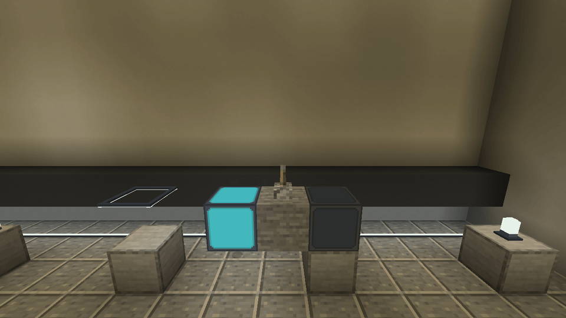
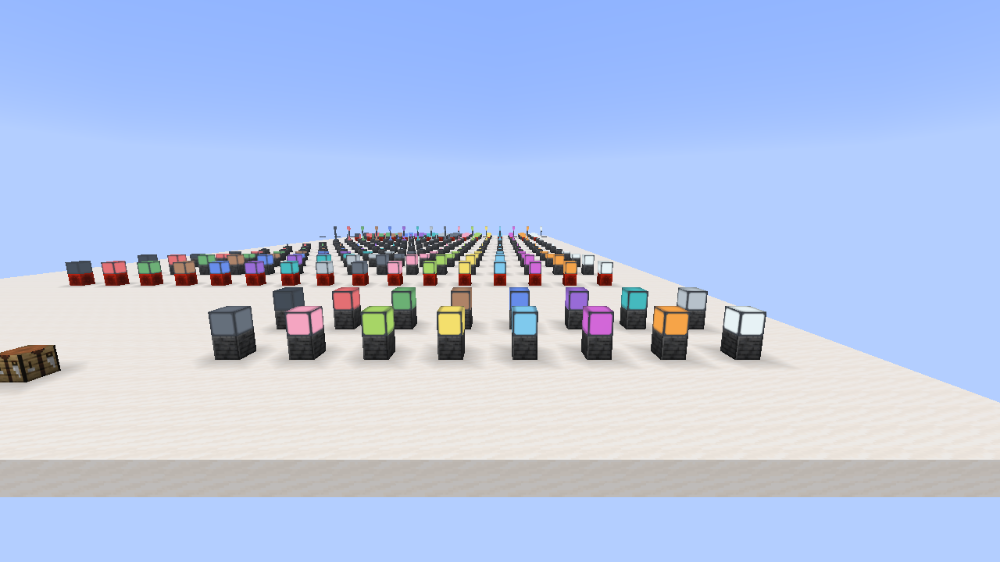

# Refeito: Simply Light

Simple LED Lighting — independent architectural lights for NeoForge.

**English first. Brazilian Portuguese follows below. / Português brasileiro abaixo da seção em inglês.**

[Download Alpha](https://github.com/Tech-teste/refeito-simply-light/releases/tag/v0.1.0-alpha.16) · [Lighting in use / Luzes em uso](docs/SHOWCASE.md)

*Actual Alpha16 with Complementary shaders. RGB also works without shaders; see the comparison below.*

## English

### Lighting for places you actually build

Give your crafting corner a warm desk lamp. Run slim light strips along a corridor. Use redstone lamps as status indicators. Build a clean wall of color with frameless lights.

The workshop below uses our bulbs, wall fixtures, ceiling rods and floor strips together. These are actual in-game captures of Alpha16, not concept art.

*Workshop shown with Sodium, Iris and ComplementaryUnbound r5.9.3. Shaders are optional.*

### RGB without a shader pack

The same room, the same camera: watch the walls and floor change when environmental RGB is enabled. This capture runs with **only Minecraft, NeoForge and this mod**. You do not need another lighting addon.

The lamps illuminate in both states. RGB adds color to nearby block surfaces; it is an optional client setting, **off by default in this Alpha**. Set `nativeRgbEnabled = true` in `config/lumaworks-client.toml`, then restart the client.

### RGB with shaders

Prefer a shader look? Here is the same workshop in the FTB Evolution 2 test copy with Sodium 0.9.2, Iris 1.11.4 and original ComplementaryUnbound r5.9.3. The comparison switches our RGB layer off and on while keeping the shader active.

Compatibility was checked with this combination; every shader handles colors differently. Entities, fluids, partial occlusion and fast continuous changes still have limits.

### Useful details, up close

The small lights shown here are always on in Alpha16. Redstone control is currently available on the full-block lamps; normal lamps turn on with a signal and inverted lamps turn off.

### Tested in game

All **224 blocks and 520 recipes** were checked, alongside English/Portuguese, water, directions, redstone and the reusable tool in the vanilla Crafter. Dedicated checks passed **34,633 assertions**. The previous full-pack run lasted **10 minutes 42 seconds**, including 256/4,096-light scenes and Complementary, near the normal **20 TPS** server target.

We also measured this furnished workshop with RGB off/on, with and without Complementary. There is no ticking block entity or task per lamp. **Client frame-time spikes remain, including in RGB-off controls.** The version is Alpha, not a promise of zero lag. [Read the measurements and limits](https://github.com/Tech-teste/refeito-simply-light/blob/main/docs/SHOWCASE.md#measurements).

Build with full blocks, slabs, quarter-block panels, compact fixtures, bulbs, floor and ceiling strips, three-block lamp posts and rod lights. All ten families have 16 colors. Full blocks, slabs and panels also have frameless items: **224 light blocks, one Finishing Wrench and 520 recipes**.

This is an independent, unofficial recreation inspired by [Simply Light by Flanks255](https://www.curseforge.com/minecraft/mc-mods/simply-light). Code, models, textures and artwork are our own. It is not an official update and is not affiliated with Flanks255, FTB or Mojang.

### Install

Minecraft **26.1.2**, NeoForge **26.1.2.126 or compatible 26.1.2 build**, Java **25**. Install one lumaworks jar on the client and server. No Simply Light, JEI, CTM, shader pack or other lighting addon is required. JEI information pages are optional. Earlier lumaworks IDs are preserved; existing simplylight blocks are not automatically converted.

### Use

- Normal full blocks turn on with redstone; inverted blocks turn off. A single lamp in a crafting grid switches between normal/inverted behavior.
- Right-click compatible lights with the Finishing Wrench to change the frame. The same conversion works in a crafting table or vanilla Crafter. The wrench is returned, without durability loss.
- Sneak + empty-hand right-click opens the compact four-direction strip editor. Changes appear in the world immediately.
- Small lights can be placed on different faces and waterlogged. Posts occupy three blocks and drop one item when dismantled.
- Lights can be worn on the head. Posts retain the playful melee-weapon function.

### Color and experimental RGB

Colored lamp textures work normally. Vanilla Minecraft still supplies ordinary white block light by default. To opt into our experimental surface-color layer, set `nativeRgbEnabled = true` in `config/lumaworks-client.toml` and restart the client; the default is **false**. It is client-side and does not add a block entity or tick task per light.

The optional layer has been tested with the standard renderer and with Sodium 0.9.2 / Iris 1.11.4 + original ComplementaryUnbound r5.9.3. Results vary between shader packs. Nearby block surfaces are supported; entities, fluids, partial occlusion and rapid continuous changes need more work. This is an alpha, not a zero-lag claim. See [validation](docs/VALIDATION.md).

### Recipes and gallery

White lights use glass, glowstone dust, redstone where relevant and iron nuggets for housings. Recolor eight matching lights with one dye. Slabs split into two quarter panels; normal/inverted blocks and upper/lower strips convert one for one. See the [full recipe guide](docs/RECIPES.md), [catalogue](docs/CATALOGUE.md) and [comparison with the original](docs/COMPARISON.md).

### Build

Java 25 and Python 3.10+ are build requirements. Run `gradlew.bat build` on Windows, or `chmod +x gradlew && ./gradlew build` on Linux. JSON, models and original pixel textures are generated deterministically from the tools in this repository. Generated resources were checked byte-for-byte against the tested candidate. The build downloads a pinned official Sodium artifact for compilation only; it never bundles Sodium or makes it a required runtime dependency.

For local engine checks, `-PsmokeTest runServer` adds the test fixture to the development run. Use a disposable development world and follow the normal Minecraft server EULA process. Build without that flag for distribution. Test fixtures and local capture/control agents are excluded from the published jar.

### Credits and license

Project credit: **ChatGPTinho**, a user-chosen nickname. Developed with assistance from OpenAI Codex/ChatGPT; this is not an OpenAI product or endorsement. Functional inspiration: Flanks255's Simply Light, published under MIT. No Simply Light assets or code are bundled. Our project remains **All Rights Reserved**; see [LICENSE.txt](LICENSE.txt). Gradle Wrapper keeps its own Apache 2.0 license.

---

## Português brasileiro

### Luzes para as construções do dia a dia

Uma luminária quente na bancada. Fitas discretas guiando o corredor. Blocos de redstone indicando o estado das máquinas. Paredes coloridas contínuas com as versões sem moldura.

A oficina usa bulbos, arandelas, barras de teto e fitas de piso juntos. As imagens são capturas reais da Alpha16 no Minecraft; a versão com shaders usa ComplementaryUnbound r5.9.3.

### RGB sem shaders

O mesmo ambiente e a mesma câmera: veja as paredes e o chão receberem cor ao ligar o RGB. Esta captura usa **somente Minecraft, NeoForge e este mod**, sem addon de iluminação.

As luminárias iluminam nos dois estados. O RGB acrescenta cor às superfícies próximas. Nesta Alpha ele começa **desligado**: ative `nativeRgbEnabled = true` em `config/lumaworks-client.toml` e reinicie o cliente.

### RGB com shaders

Aqui o Complementary continua ativo enquanto ligamos e desligamos nossa camada de cor, na cópia de teste do FTB Evolution 2 com Sodium/Iris.

Cada shader pode tratar as cores de um jeito. Entidades, fluidos, oclusão parcial e mudanças rápidas ainda têm limitações.

### Sinalização para sua oficina

Na Alpha16, os blocos inteiros aceitam redstone normal/invertida. As luminárias pequenas mostradas ficam sempre acesas; versões pequenas controláveis ainda não fazem parte desta versão.

### Desempenho conferido

Foram conferidos os **224 blocos, 520 receitas, os dois idiomas e 34.633 verificações do servidor**, incluindo redstone e a chave no Crafter. O teste anterior no pack durou **10min42s**, com cenas de até 4.096 luzes, mantendo TPS próximos de 20.

Também medimos esta oficina com RGB ligado/desligado, com e sem Complementary. Não há entidade de bloco ou tarefa rodando por lâmpada. **Ainda apareceram engasgos gráficos, inclusive com RGB desligado.** A Alpha não promete zero lag. [Veja as medições e os limites](https://github.com/Tech-teste/refeito-simply-light/blob/main/docs/SHOWCASE.md#measurements).

Luminárias arquitetônicas em dez famílias e 16 cores: blocos, lajes, painéis de um quarto de bloco, arandelas, bulbos, fitas inferiores/superiores, postes de três blocos e barras. Com variantes sem moldura para blocos, lajes e painéis: **224 blocos, uma Chave de Acabamento e 520 receitas**.

É uma recriação independente e não oficial inspirada no Simply Light, de Flanks255. Código, modelos, texturas e arte são próprios. Não há afiliação com o autor original, FTB, Mojang ou OpenAI.

### Instalação e uso

Minecraft **26.1.2**, NeoForge **26.1.2.126** e Java **25**. Instale um único jar lumaworks no cliente e no servidor. Não requer Simply Light, JEI, CTM, shaders ou addon de iluminação. Não converte automaticamente blocos antigos de simplylight.

- Bloco normal acende com redstone; invertido apaga. Um bloco sozinho na bancada alterna o comportamento.
- A chave troca a moldura no mundo ou na bancada/Crafter. Ela retorna sem desgaste.
- Agachar + botão direito com a mão vazia abre os quatro interruptores da fita.
- As peças pequenas admitem outras orientações e água. O poste desmonta sem deixar partes órfãs e entrega um item.
- Luminárias podem ser usadas na cabeça; postes mantêm a função de arma.

As texturas coloridas funcionam normalmente. A luz do Minecraft continua branca por padrão. Para experimentar a cor nas superfícies, ative `nativeRgbEnabled = true` em `config/lumaworks-client.toml` e reinicie o cliente. A opção começa desligada, é do cliente e não cria uma tarefa por lâmpada. Testada com renderizador padrão e Sodium/Iris + Complementary; entidades, fluidos, oclusão parcial e mudanças rápidas ainda têm limites. Não há promessa de zero lag.

Os crafts usam materiais vanilla. Recoloração: oito luminárias e um corante; laje vira dois painéis; normal/invertida e fita superior/inferior trocam um por um. Veja [receitas](docs/RECIPES.md), [catálogo](docs/CATALOGUE.md), [comparação](docs/COMPARISON.md) e [testes](docs/VALIDATION.md).

Para compilar: Java 25, Python 3.10+ e `gradlew.bat build`. A geração dos recursos é reproduzível. Sodium entra apenas como API de compilação, sem ser incluído no jar. Crédito escolhido: **ChatGPTinho**. Licença atual: **All Rights Reserved**.
