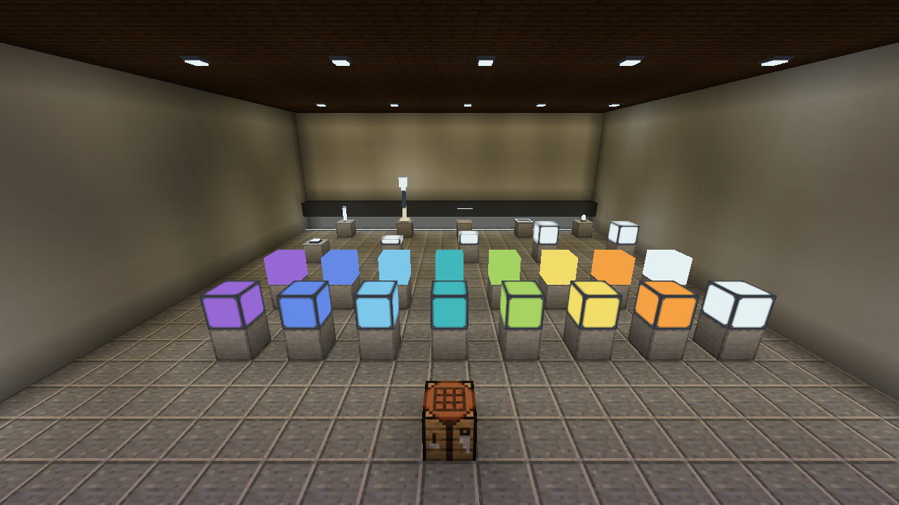

# Refeito: Simply Light

Simple LED Lighting — independent architectural lights for NeoForge.

**English first. Brazilian Portuguese follows below. / Português brasileiro abaixo da seção em inglês.**

## English

Build with full blocks, slabs, quarter-block panels, compact fixtures, bulbs, floor and ceiling strips, three-block lamp posts and rod lights. All ten families have 16 colors. Full blocks, slabs and panels also have frameless items: **224 light blocks, one Finishing Wrench and 520 recipes**.

This is an independent, unofficial recreation inspired by [Simply Light by Flanks255](https://www.curseforge.com/minecraft/mc-mods/simply-light). Code, models, textures and artwork are our own. It is not an official update and is not affiliated with Flanks255, FTB or Mojang.

### Install

Minecraft **26.1.2**, NeoForge **26.1.2.126 or compatible 26.1.2 build**, Java **25**. Install one lumaworks jar on the client and server. No Simply Light, JEI, CTM, shader pack or other lighting addon is required. JEI information pages are optional. Earlier lumaworks IDs are preserved; existing simplylight blocks are not automatically converted.

### Use

- Normal full blocks turn on with redstone; inverted blocks turn off. A single lamp in a crafting grid switches between normal/inverted behavior.
- Right-click compatible lights with the Finishing Wrench to change the frame. The same conversion works in a crafting table or vanilla Crafter. The wrench is returned, without durability loss.
- Sneak + empty-hand right-click opens the compact four-direction strip editor. Changes appear in the world immediately.
- Small lights can be placed on different faces and waterlogged. Posts occupy three blocks and drop one item when dismantled.
- Lights can be worn on the head. Posts retain the playful melee-weapon function.

### Color and experimental RGB

Colored lamp textures work normally. Vanilla Minecraft still supplies ordinary white block light by default. To opt into our experimental surface-color layer, set `nativeRgbEnabled = true` in `config/lumaworks-client.toml` and restart the client; the default is **false**. It is client-side and does not add a block entity or tick task per light.

The optional layer has been tested with the standard renderer and with Sodium 0.9.2 / Iris 1.11.4 + original ComplementaryUnbound r5.9.3. Results vary between shader packs. Nearby block surfaces are supported; entities, fluids, partial occlusion and rapid continuous changes need more work. This is an alpha, not a zero-lag claim. See [validation](docs/VALIDATION.md).

### Recipes and gallery

White lights use glass, glowstone dust, redstone where relevant and iron nuggets for housings. Recolor eight matching lights with one dye. Slabs split into two quarter panels; normal/inverted blocks and upper/lower strips convert one for one. See the [full recipe guide](docs/RECIPES.md), [catalogue](docs/CATALOGUE.md) and [comparison with the original](docs/COMPARISON.md).

### Build

Java 25 and Python 3.10+ are build requirements. Run `gradlew.bat build` on Windows, or `chmod +x gradlew && ./gradlew build` on Linux. JSON, models and original pixel textures are generated deterministically from the tools in this repository. Generated resources were checked byte-for-byte against the tested candidate. The build downloads a pinned official Sodium artifact for compilation only; it never bundles Sodium or makes it a required runtime dependency.

For local engine checks, `-PsmokeTest runServer` adds the test fixture to the development run. Use a disposable development world and follow the normal Minecraft server EULA process. Build without that flag for distribution. Test fixtures and local capture/control agents are excluded from the published jar.

### Credits and license

Project credit: **ChatGPTinho**, a user-chosen nickname. Developed with assistance from OpenAI Codex/ChatGPT; this is not an OpenAI product or endorsement. Functional inspiration: Flanks255's Simply Light, published under MIT. No Simply Light assets or code are bundled. Our project remains **All Rights Reserved**; see [LICENSE.txt](LICENSE.txt). Gradle Wrapper keeps its own Apache 2.0 license.

---

## Português brasileiro

Luminárias arquitetônicas em dez famílias e 16 cores: blocos, lajes, painéis de um quarto de bloco, arandelas, bulbos, fitas inferiores/superiores, postes de três blocos e barras. Com variantes sem moldura para blocos, lajes e painéis: **224 blocos, uma Chave de Acabamento e 520 receitas**.

É uma recriação independente e não oficial inspirada no Simply Light, de Flanks255. Código, modelos, texturas e arte são próprios. Não há afiliação com o autor original, FTB, Mojang ou OpenAI.

### Instalação e uso

Minecraft **26.1.2**, NeoForge **26.1.2.126** e Java **25**. Instale um único jar lumaworks no cliente e no servidor. Não requer Simply Light, JEI, CTM, shaders ou addon de iluminação. Não converte automaticamente blocos antigos de simplylight.

- Bloco normal acende com redstone; invertido apaga. Um bloco sozinho na bancada alterna o comportamento.
- A chave troca a moldura no mundo ou na bancada/Crafter. Ela retorna sem desgaste.
- Agachar + botão direito com a mão vazia abre os quatro interruptores da fita.
- As peças pequenas admitem outras orientações e água. O poste desmonta sem deixar partes órfãs e entrega um item.
- Luminárias podem ser usadas na cabeça; postes mantêm a função de arma.

As texturas coloridas funcionam normalmente. A luz do Minecraft continua branca por padrão. Para experimentar a cor nas superfícies, ative `nativeRgbEnabled = true` em `config/lumaworks-client.toml` e reinicie o cliente. A opção começa desligada, é do cliente e não cria uma tarefa por lâmpada. Testada com renderizador padrão e Sodium/Iris + Complementary; entidades, fluidos, oclusão parcial e mudanças rápidas ainda têm limites. Não há promessa de zero lag.

Os crafts usam materiais vanilla. Recoloração: oito luminárias e um corante; laje vira dois painéis; normal/invertida e fita superior/inferior trocam um por um. Veja [receitas](docs/RECIPES.md), [catálogo](docs/CATALOGUE.md), [comparação](docs/COMPARISON.md) e [testes](docs/VALIDATION.md).

Para compilar: Java 25, Python 3.10+ e `gradlew.bat build`. A geração dos recursos é reproduzível. Sodium entra apenas como API de compilação, sem ser incluído no jar. Crédito escolhido: **ChatGPTinho**. Licença atual: **All Rights Reserved**.
