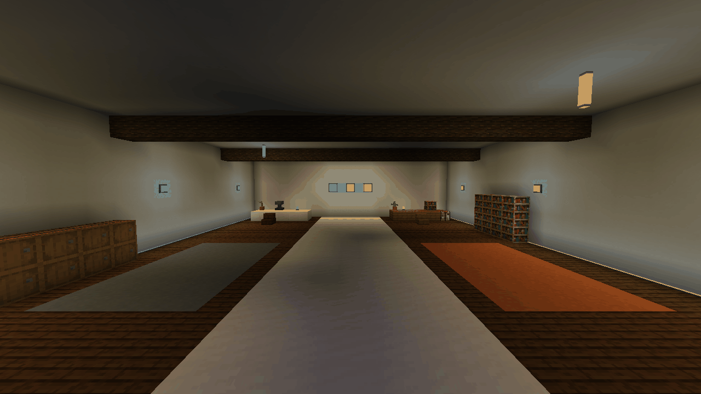
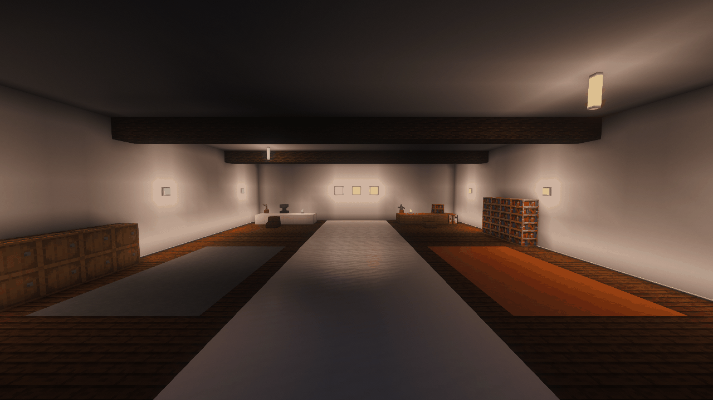

# Simply Light: Reforged RGB

Architectural lighting in 16 colours for Minecraft 26.1.2 and NeoForge 26.1.2.126. Build with full blocks, slabs, panels, fixtures, bulbs, light bars, three-block posts and adjustable edge strips. Choose framed or frameless finishes, use redstone to control small and large lamps, and add experimental coloured light to nearby block surfaces.

Independent and unofficial, inspired by [Simply Light by Flanks255](https://www.curseforge.com/minecraft/mc-mods/simply-light). Original code, models and textures; no original Simply Light code/assets bundled.432 light blocks, one Finishing Wrench and 1,081 recipes.

**Alpha28 review candidate — binary not published.** Retains Alpha27 item-name/model fixes and corrects the Portuguese strip-editor hitbox. Current functional and visual checks are summarized in [Alpha28 review status](docs/review28/STATUS.md). Main and the existing binary release are older. The full publication audit remains open.

## Surface RGB in the actual game



Sodium, no shader: RGB manually switched off/on. / Sodium, sem shader: RGB alternado manualmente. Real Alpha27 captures, full1280 ×720 frames.



Iris + Complementary Unbound: RGB manually switched off/on. / Iris + Complementary Unbound: RGB alternado manualmente. These GIFs do not demonstrate automatic colour cycling.

## Install and use

Install the same mod jar on client and server. Requires Java 25, Minecraft 26.1.2 and NeoForge 26.1.2.126. No JEI, Sodium, Iris or shader dependency is required.

Surface RGB is enabled for new installations and respects existing preferences. Change it locally through **Mods → Simply Light: Reforged RGB → Config**. Commands: /lumargb on, off, toggle, status, guide. An optional shortcut is unbound by default. A seven-page in-game guide explains the mechanics.

- Normal redstone lamps turn on with a signal; inverted lamps turn off. Craft a controlled lamp alone to switch mode.
- Use the reusable Finishing Wrench in-world, in a crafting table or in a Crafter to change compatible frames. The tool returns without wear.
- Recolour matching lights with dye. Sneak and empty-hand right-click opens strip edge controls. Wall-strip edges are manually selected.
- Waterlogging is supported where applicable; three-block posts dismantle to one item. Lamps can be worn and posts retain their melee function.

Existing lumaworks identifiers are preserved. Worlds from the original simplylight namespace are not automatically converted. Create moving-contraption integration has not been verified for this target.

## Test evidence and limits

[Captured-spike diagnosis and Spark snapshot](docs/review27/DIAGNOSIS.md) · [160-ID reference comparison](docs/review27/COMPARISON.md) · [Current Alpha28 review](docs/review28/STATUS.md) · [Active RGB / shader follow-up](docs/review28/PERFORMANCE-SLOW.md) · [Crafter and water persistence](docs/review28/AUTOMATION-WATER.md) · [Standalone heap/GC run](docs/review27/PERFORMANCE-STANDALONE.md) · [FTB/Sodium/Iris measurements](docs/review27/PERFORMANCE-PACK.md).

Actual432 lamp-item names passed in both languages. The current pack run recorded8 minutes across 16 windows: workshop RGB off/on, fast redstone and 4,096 lamp scenes with Sodium and Iris/Complementary. Emission checks passed and queues cleared at settling checkpoints.

**Performance is still under investigation.** Observed pack spikes include 286 ms render interval with RGB off and 298 ms tick with RGB on; shader tick spikes occurred in both states. No zero-lag, no-impact or FPS-gain claim. The reports identify hardware, GC/heap counters and measurement limitations. Offscreen render callback intervals are not visible-monitor FPS.

RGB colours nearby block surfaces. Entities, fluids, partial occlusion, range and shader-dependent appearance have limitations. Rapid continuous changes can temporarily pause the colour layer, which recovers after changes settle. This bounded test does not prove absence of slow memory leaks.

## Build

Java 25, Python 3.13 and Pillow 13.0.0. Install the asset dependency with python -m pip install Pillow==13.0.0, then run gradlew.bat build (Windows) or ./gradlew build. Assets and recipe checks run automatically. Sodium/JEI APIs are compile-only, never bundled. Optional development fixtures are excluded from ordinary builds.

## Português brasileiro

Iluminação arquitetônica em 16 cores para Minecraft 26.1.2/NeoForge 26.1.2.126. Blocos inteiros, lajes, painéis, luminárias, bulbos, barras, postes de três blocos e fitas ajustáveis. Acabamentos com/sem moldura, variantes normais/invertidas de redstone e RGB experimental colorindo superfícies próximas.

Recriação independente e não oficial inspirada no Simply Light de Flanks255. Código, modelos e texturas próprios.432 luminárias, Chave de Acabamento reutilizável e 1.081 receitas. As imagens acima aparecem uma única vez, com legendas nos dois idiomas.

**Alpha28 em revisão, sem binário publicado.** Mantém as correções de nomes/modelos da Alpha27 e corrige a área clicável do editor em português. Novas verificações de guia, persistência e fabricação estão no [resumo atual](docs/review28/STATUS.md). Instale o mesmo jar no cliente/servidor; Java 25 obrigatório. Não exige JEI, Sodium, Iris ou shaders.

RGB ligado em instalações novas, preservando preferências existentes. Ative/desative em **Mods → Simply Light: Reforged RGB → Configurar**, sem comando. Também há /lumargb on/off/toggle/status/guide, atalho opcional sem tecla padrão e guia de sete páginas.

Luminárias normais acendem com sinal; invertidas apagam. Uma peça controlável sozinha na bancada alterna o modo. A chave muda molduras no mundo, bancada e Crafter, retornando sem desgaste. Corantes recolorem; agachar e clicar com mão vazia abre o editor das fitas. Bordas de parede são manuais. Água onde suportada; postes quebrados entregam um item. Luzes podem ir à cabeça e postes mantêm função de arma.

Preserva IDs lumaworks; não converte automaticamente mundos simplylight. Create em estruturas móveis não foi comprovado neste alvo. RGB tem limites em entidades, fluidos, oclusão parcial, alcance e shaders; mudanças rápidas podem pausar temporariamente a cor.

O teste atual no FTB somou 8 min de medição com Sodium e Iris/Complementary. As verificações de emissão passaram e as filas zeraram ao estabilizar. **Ainda há engasgos a investigar:** quadro de 286 ms com RGB desligado e tick de 298 ms com RGB ligado; com shader houve picos nos dois estados. Não promete zero lag nem ganho de FPS. Memória/GC e limites estão nos relatórios; captura fora da tela não equivale ao FPS do monitor.

Compilar: Java 25, Python 3.13 e Pillow 13.0.0; instale python -m pip install Pillow==13.0.0 e execute gradlew.bat build. Recursos e receitas são gerados/verificados automaticamente.

License: All Rights Reserved. Gradle retains its bundled licence. Credit: ChatGPTinho, the user-selected nickname, developed with assistance from OpenAI Codex/ChatGPT. No affiliation with OpenAI, Flanks255, FTB or Mojang.
