# Block catalogue / Catálogo de blocos

All ten base families have sixteen colors. / Todas as dez famílias têm dezesseis cores.

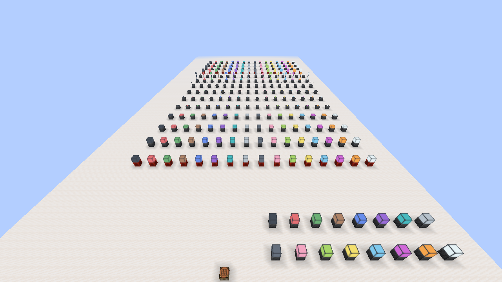

### Signal

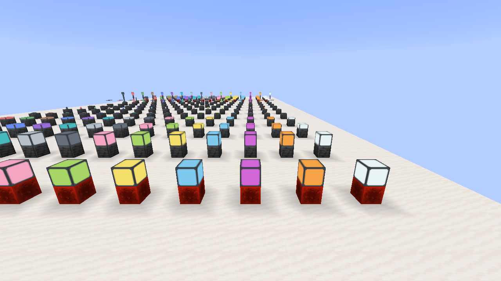

### Inverse

### Slab

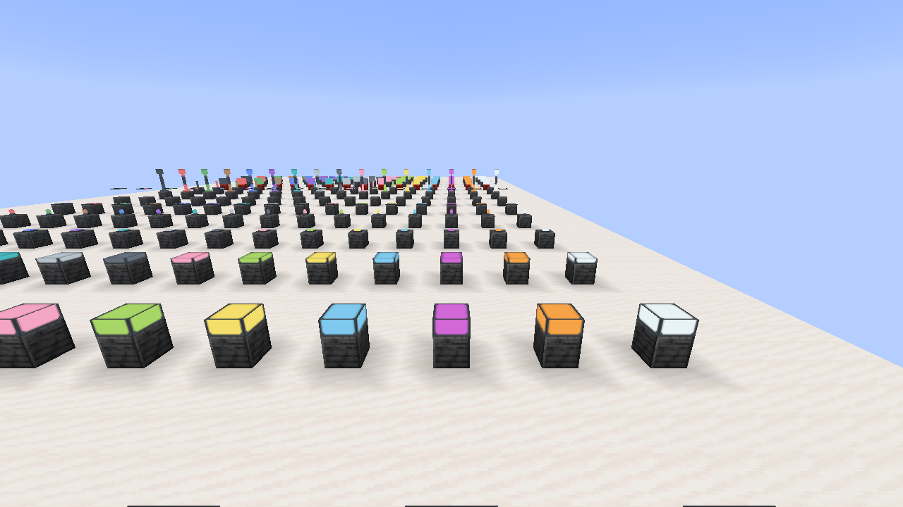

### Panel

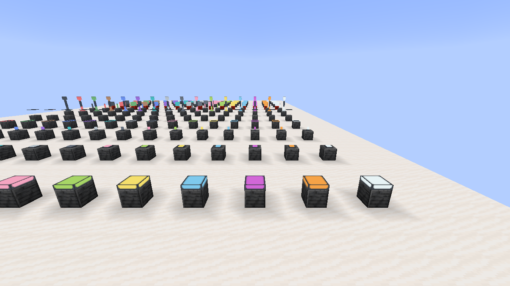

### Fixture

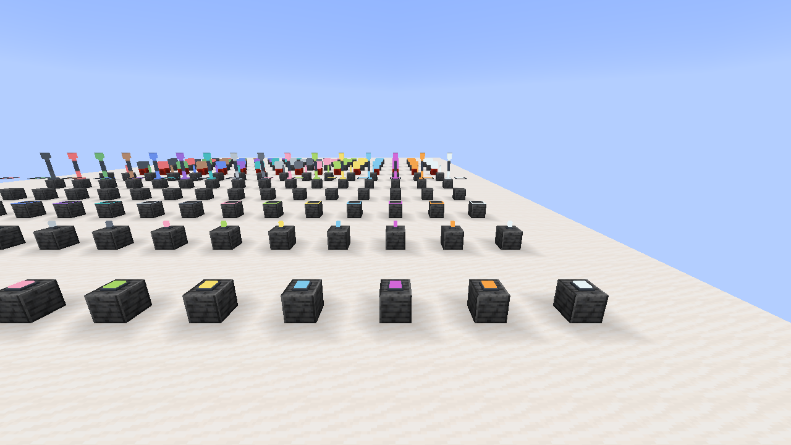

### Bulb

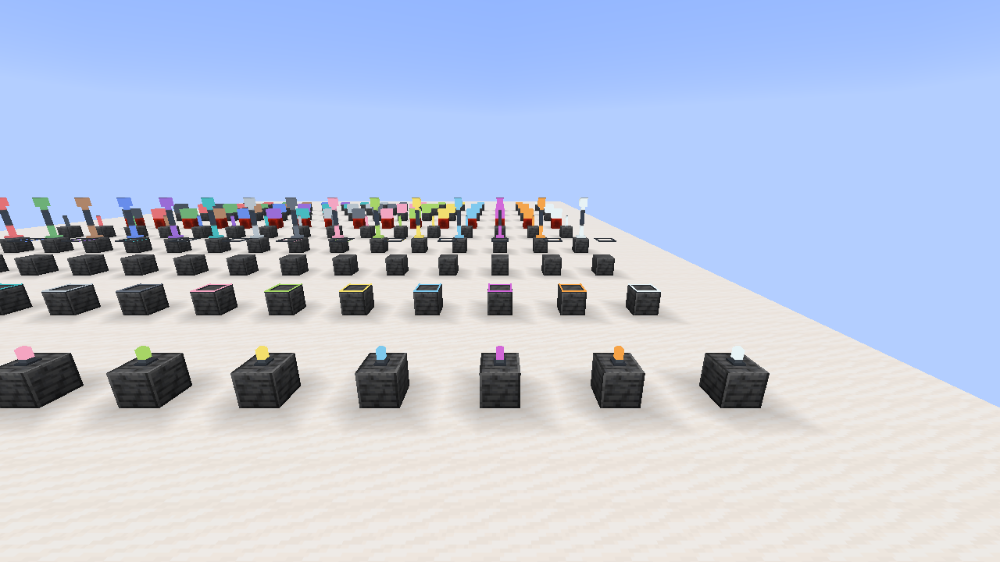

### Strip Low

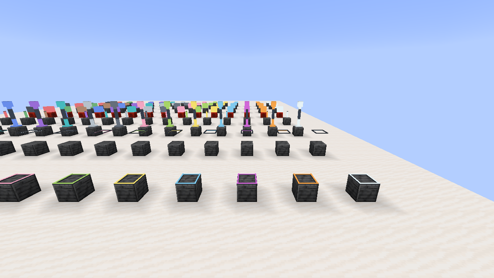

### Strip High

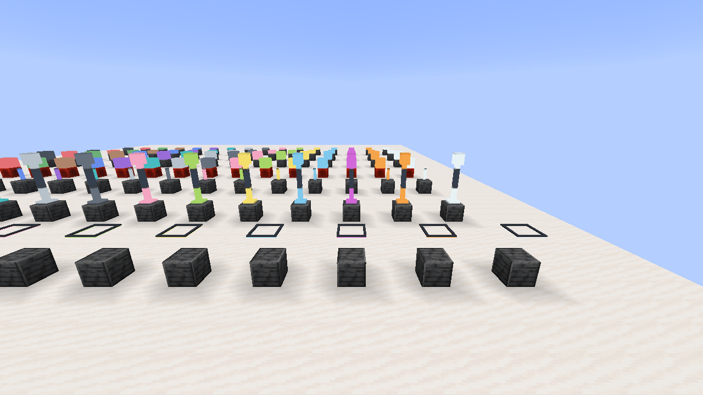

### Column

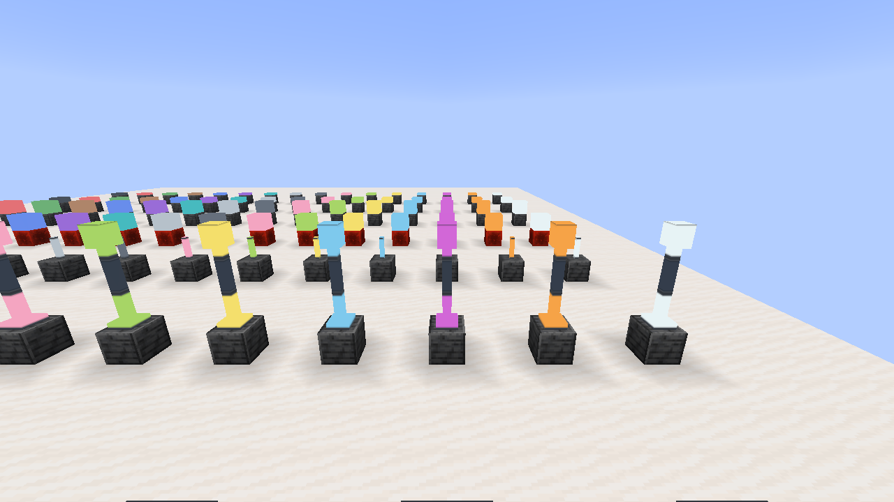

### Tube

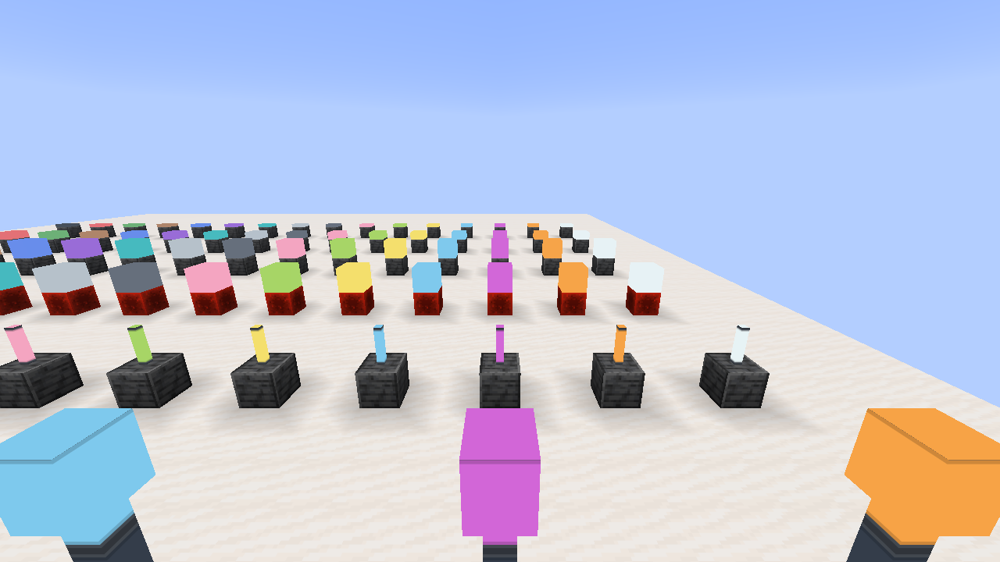

## Frameless / Sem moldura

64 additional items: normal/inverted full blocks, slabs and panels in all sixteen colors. The wrench converts the placed block or works as a reusable recipe ingredient. / 64 itens adicionais sem moldura; a chave converte no mundo ou na bancada.

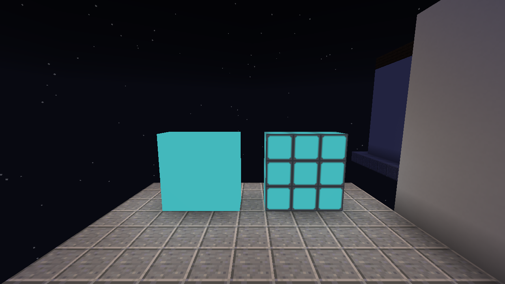

## Builds and RGB / Construções e RGB

[See furnished rooms, RGB comparisons and redstone animations / Veja ambientes, comparações RGB e animações de redstone](SHOWCASE.md).
