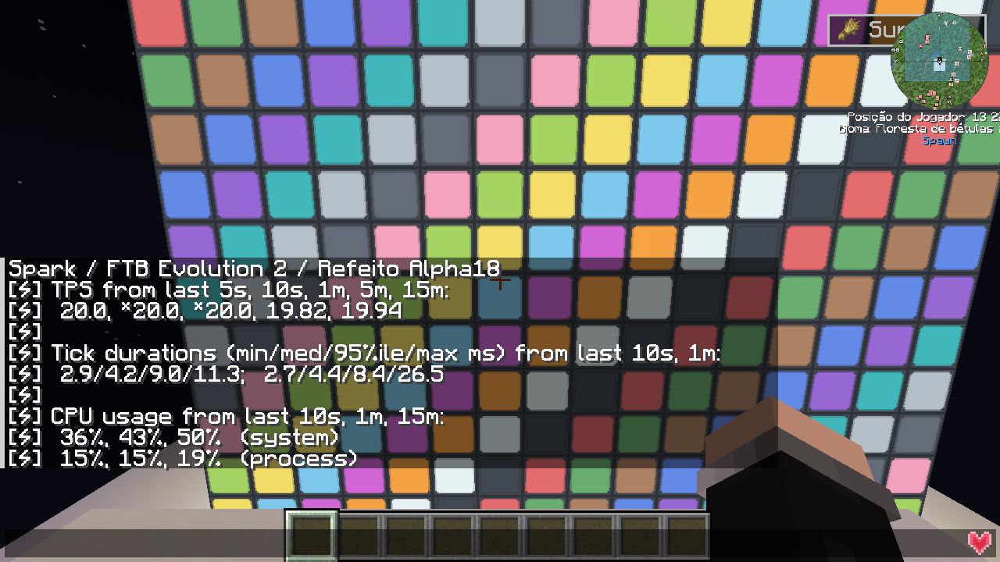
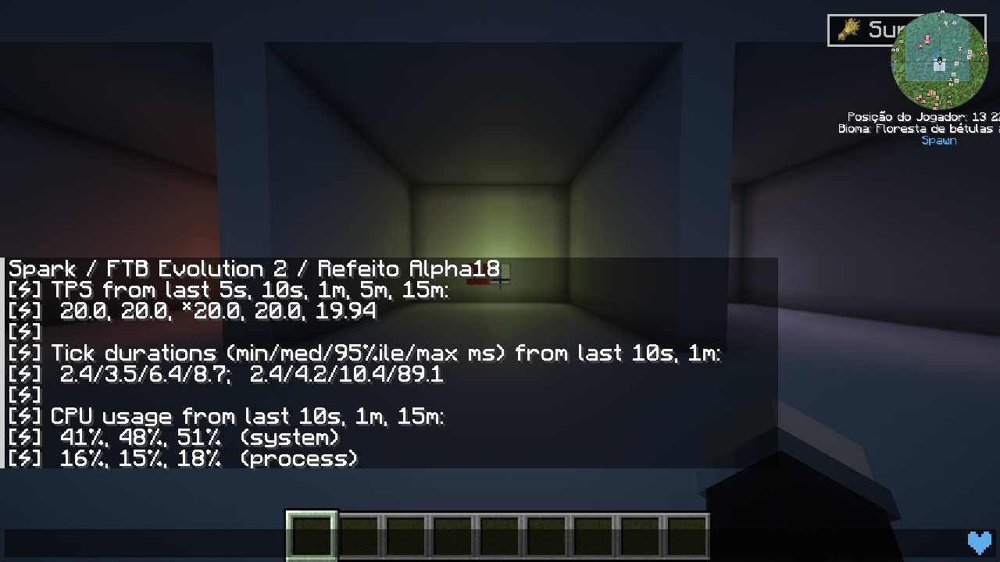

# Measured in a real modpack / Medido no modpack

## English

**Development build Alpha18 — not the public Alpha16 download.** Measured on November 5, 2026 in an isolated FTB Evolution 2 copy, with Sodium 0.9.2 and Iris 1.11.4. Eight 30-second measurement windows (240 seconds total), plus a separate 60-second Spark profile. The shader scene used original ComplementaryUnbound r5.9.3 and 12 redstone transitions per window. Static stress: 4,096 lamps, RGB off/on, compared with 4,096 vanilla glowstone blocks at the same position. The stress sequence was repeated in reverse order. Construction and shader loading were outside the measured windows; these are steady-scene tests, not a placement-speed or multiplayer benchmark.

### Server kept up on average; occasional stalls remain

All eight windows averaged close to 20 TPS. This does not mean zero lag: individual slow ticks and frames occurred, including with RGB disabled and in the glowstone control. The second lamp pair ran slower in both modes. These tests do not isolate all causes or establish a universal overhead percentage.

| Scene / round | TPS | Tick p95 ms | Largest tick ms | Frame p99 ms | Largest frame ms | Frames >50ms |
|---|---:|---:|---:|---:|---:|---:|
| 4,096 glowstone / 1 | 19.97 | 9.97 | 52.43 | 6.59 | 248.31 | 4 |
| 4,096 lamps / RGB OFF / 1 | 20.00 | 9.31 | 27.81 | 4.81 | 54.26 | 1 |
| 4,096 lamps / RGB ON / 1 | 20.00 | 8.67 | 18.93 | 4.86 | 51.25 | 1 |
| 4,096 lamps / RGB ON / 2 | 20.00 | 16.64 | 112.37 | 7.68 | 89.77 | 4 |
| 4,096 lamps / RGB OFF / 2 | 20.00 | 15.40 | 675.23 | 7.60 | 67.12 | 1 |
| 4,096 glowstone / 2 | 20.00 | 10.25 | 20.33 | 5.38 | 65.55 | 1 |
| 3 lamps / Complementary / RGB OFF / 1 | 20.00 | 8.48 | 23.59 | 7.24 | 32.36 | 0 |
| 3 lamps / Complementary / RGB ON / 1 | 20.00 | 5.98 | 23.11 | 5.98 | 30.41 | 0 |

Lower millisecond times are better. 20 TPS is Minecraft's normal server target; 50 ms is its tick budget. The server can catch up after individual slow ticks, so average TPS must be read alongside the worst ticks. Frame times describe the client, not the server.

### Actual Spark output, in game

The chat displays the captured `/spark tps` response.5s/10s/1m/5m/15m are rolling windows; the longer windows include earlier loading or previous cases, not just this scene. CPU numbers refer to the whole game process/system, not exclusively this mod. The header identifies our test. No values were painted over the screenshot.

### Conditions and profiler scope

Intel Core i5-14600K, NVIDIA RTX 5060, approximately 48 GiB system memory, 6 GiB Java heap; Minecraft 26.1.2, NeoForge 26.1.2.126, Java 25. Measurements used a 1280×720 offscreen render target with temporary inactivity throttling suspended, without Windows mouse/keyboard input. Other applications shared the PC. These FPS/frame figures are not promises of visible-game FPS on another computer. Test clients were muted; temporary settings and observers were restored.

Spark 1.10.187 was used for TPS/MSPT/health and a separate all-thread CPU sample (10 ms interval), saved locally without upload. Raw profiles/logs stay private. Sampling is an estimate, not exact per-mod CPU accounting. No block entity or recurring tick task is created per lamp. Rendering and lighting updates still have costs.

Observable Remake 1.0.3 was attempted from its official CurseForge file 8880837. Startup failed before the world opened: its bundled kotlinx-serialization range [1.10.0,1.11.0) conflicts with this pack's KotlinLangForge 1.12.0+. It was removed; pack libraries were not replaced. Therefore no Observable heatmap is claimed. Observable's block/entity tick view would not by itself measure our client RGB rendering cost.

Public Alpha16 results remain in[VALIDATION.md](https://github.com/Tech-teste/refeito-simply-light/blob/main/docs/VALIDATION.md). These newer candidate measurements must not be presented as an Alpha16 benchmark.

## Português brasileiro

**Teste da candidata Alpha18; o download público continua Alpha16.** Foram oito janelas de 30 s no FTB Evolution 2: 4.096 luminárias com RGB ligado/desligado, 4.096 glowstones como referência e três luzes com Complementary e 12 trocas de redstone por janela. A sequência de estresse foi repetida em ordem inversa. Também gravamos um perfil separado de 60 s pelo Spark.

As médias ficaram perto de 20 TPS, mas apareceram travadas pontuais de ticks e quadros, inclusive nos controles sem RGB. A tabela mostra todas as rodadas. Menos milissegundos é melhor; 20 TPS é a meta normal do servidor, não uma garantia de imagem sem engasgos. A segunda dupla de testes com luminárias ficou mais lenta nos dois modos, sem causa isolada.

Prints reais acima mostram a saída do Spark; os valores não foram pintados. Os números de CPU são do processo/sistema inteiro. Os testes foram fora da tela em 1280×720, com outros programas compartilhando o PC; não prometem FPS universal ou zero lag. Não há tarefa ou entidade de bloco rodando por lâmpada, mas renderização e atualização de iluminação têm custo.

O Observable Remake foi tentado e retirado após conflito entre sua biblioteca Kotlin e a do pack. Não trocamos bibliotecas do FTB e não apresentamos um mapa de calor inexistente. O Spark foi usado de fato; perfil bruto ficou local. O mod continuou funcionando com Sodium/Iris, e as opções temporárias foram restauradas.

Sources:[Spark command documentation](https://spark.lucko.me/docs/Command-Usage),[TPS/MSPT guide](https://spark.lucko.me/docs/guides/TPS-and-MSPT),[Observable Remake file](https://www.curseforge.com/minecraft/mc-mods/observable-remake/files/8880837).
