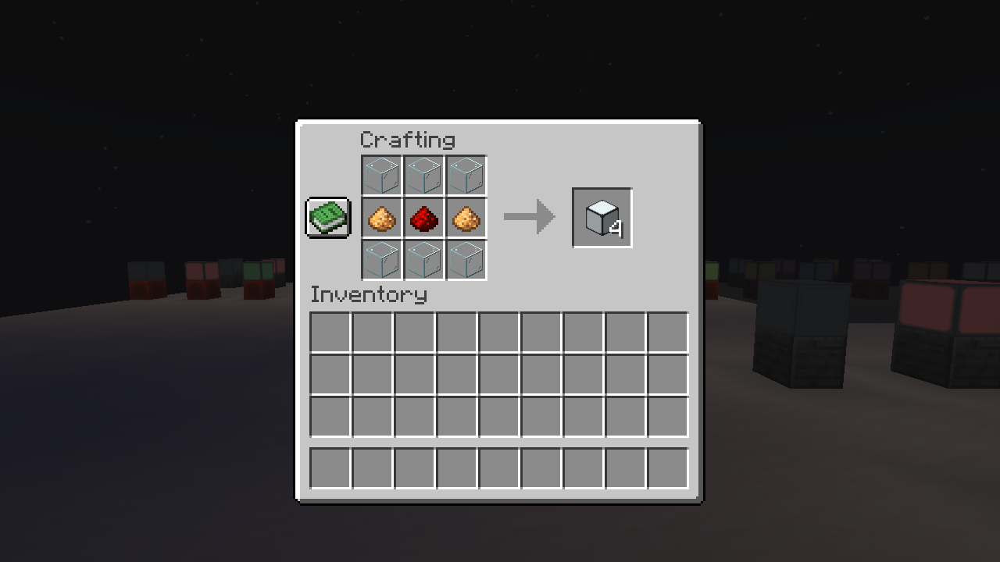
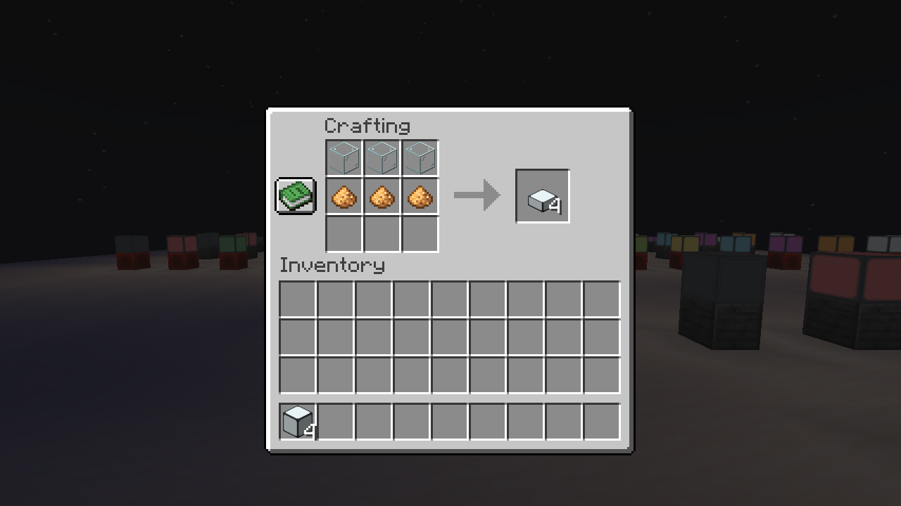
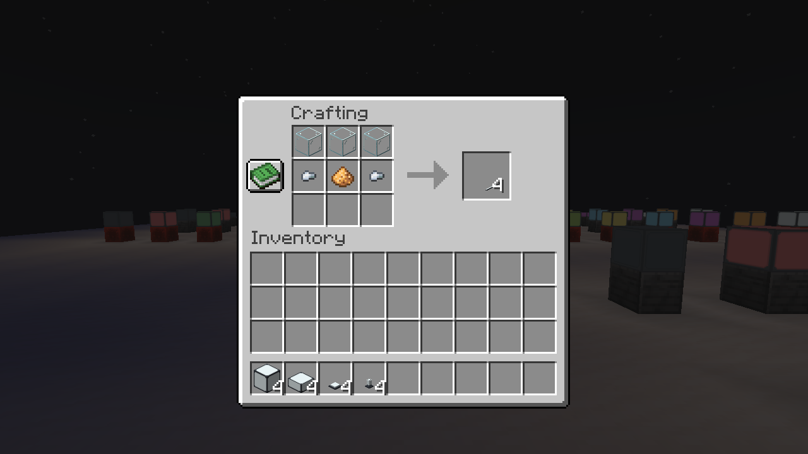
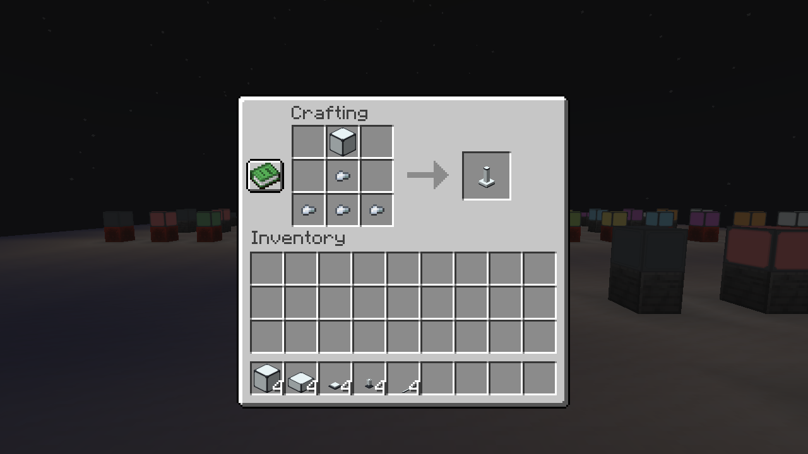
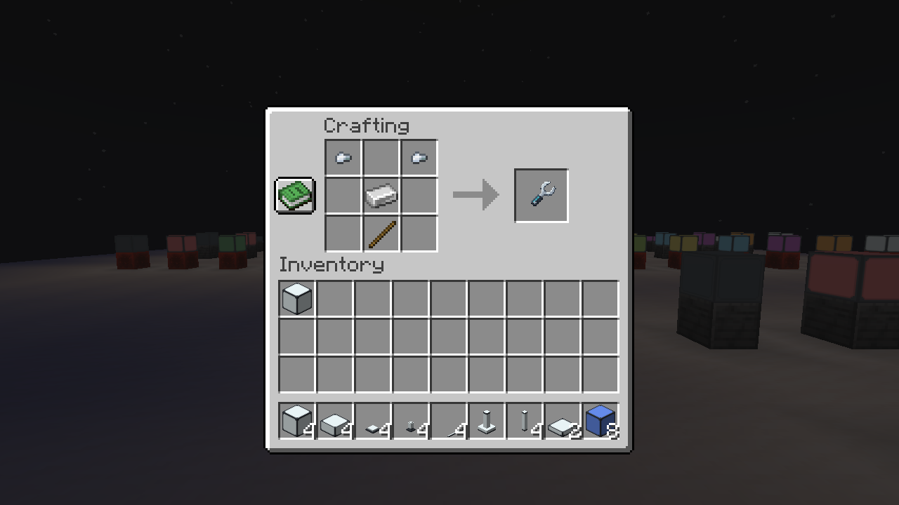
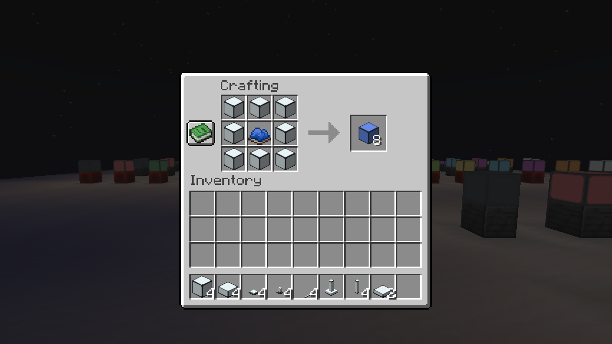
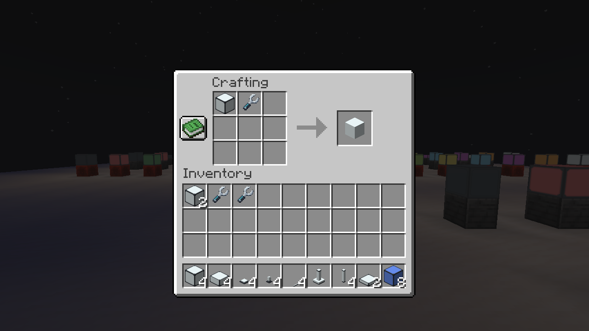

# Recipes / Receitas

English first; português abaixo. Every ingredient is vanilla or one of our lights/tool. No addon materials are required.

`G` = glass; `D` = glowstone dust; `I` = iron nugget; `R` = redstone; `L` = matching light; a blank square is empty. The complete patterns below come from the actual recipe JSON, not the original mod's artwork.

## White base lights

### White Signal

Output / Rendimento: 4

```text
GGG
DRD
GGG
```

G = minecraft:glass, D = minecraft:glowstone_dust, R = minecraft:redstone



### White Slab

Output / Rendimento: 4

```text
GGG
DDD
```

G = minecraft:glass, D = minecraft:glowstone_dust



### White Fixture

Output / Rendimento: 4

```text
G G
DID
```

G = minecraft:glass, D = minecraft:glowstone_dust, I = minecraft:iron_nugget


### White Bulb

Output / Rendimento: 4

```text
 G 
 D 
 I 
```

G = minecraft:glass, D = minecraft:glowstone_dust, I = minecraft:iron_nugget


### White Strip Low

Output / Rendimento: 4

```text
GGG
IDI
```

G = minecraft:glass, D = minecraft:glowstone_dust, I = minecraft:iron_nugget



### White Column

Output / Rendimento: 1

```text
 G 
 I 
III
```

G = lumaworks:white_signal, I = minecraft:iron_nugget



### White Tube

Output / Rendimento: 4

```text
IGI
 D 
IGI
```

G = minecraft:glass, D = minecraft:glowstone_dust, I = minecraft:iron_nugget


### Finishing Key

Output / Rendimento: 1

```text
N N
 I 
 S 
```

N = minecraft:iron_nugget, I = minecraft:iron_ingot, S = minecraft:stick



## Conversions

- Eight matching lights + one dye → eight recolored lights. Framed and frameless recipes are separate.
- One normal full block ↔ one inverted full block, without extra material.
- One lower strip ↔ one upper strip, without extra material.
- One slab → two quarter panels; two panels → one slab.
- Light + Finishing Wrench → opposite finish. The tool returns to the grid/Crafter and has no durability cost.





## Português brasileiro

Os materiais são vanilla: vidro para o difusor, pó de glowstone para a luz, redstone no bloco controlável e pepitas de ferro nos suportes. Os padrões acima são as receitas reais do nosso mod. A receita do poste usa uma luminária branca e ferro; seu rendimento é um poste completo de três blocos.

Oito luminárias iguais e um corante rendem oito da nova cor. Normal/invertida e fita superior/inferior trocam um por um. Uma laje rende dois painéis de um quarto; dois painéis refazem uma laje. A chave remove/recoloca a moldura e volta à bancada ou ao Crafter, sem desgaste. A receita da própria chave usa duas pepitas, um lingote de ferro e um graveto.

## Complete recipe index / Índice completo

The generator is the authoritative editable source. / O gerador é a fonte editável das receitas.

| Recipe ID | Output | Count |
|---|---|---:|
| `black_bulb_recolor` | `lumaworks:black_bulb` | 8 |
| `black_column_recolor` | `lumaworks:black_column` | 8 |
| `black_fixture_recolor` | `lumaworks:black_fixture` | 8 |
| `black_inverse_frame` | `lumaworks:black_inverse` | 1 |
| `black_inverse_normalize` | `lumaworks:black_signal` | 1 |
| `black_inverse_recolor` | `lumaworks:black_inverse` | 8 |
| `black_inverse_seamless_finish` | `lumaworks:black_inverse_seamless` | 1 |
| `black_inverse_seamless_recolor` | `lumaworks:black_inverse_seamless` | 8 |
| `black_inverse_seamless_toggle` | `lumaworks:black_signal_seamless` | 1 |
| `black_panel_combine` | `lumaworks:black_slab` | 1 |
| `black_panel_frame` | `lumaworks:black_panel` | 1 |
| `black_panel_recolor` | `lumaworks:black_panel` | 8 |
| `black_panel_seamless_combine` | `lumaworks:black_slab_seamless` | 1 |
| `black_panel_seamless_finish` | `lumaworks:black_panel_seamless` | 1 |
| `black_panel_seamless_recolor` | `lumaworks:black_panel_seamless` | 8 |
| `black_signal_frame` | `lumaworks:black_signal` | 1 |
| `black_signal_invert` | `lumaworks:black_inverse` | 1 |
| `black_signal_recolor` | `lumaworks:black_signal` | 8 |
| `black_signal_seamless_finish` | `lumaworks:black_signal_seamless` | 1 |
| `black_signal_seamless_recolor` | `lumaworks:black_signal_seamless` | 8 |
| `black_signal_seamless_toggle` | `lumaworks:black_inverse_seamless` | 1 |
| `black_slab_frame` | `lumaworks:black_slab` | 1 |
| `black_slab_recolor` | `lumaworks:black_slab` | 8 |
| `black_slab_seamless_finish` | `lumaworks:black_slab_seamless` | 1 |
| `black_slab_seamless_recolor` | `lumaworks:black_slab_seamless` | 8 |
| `black_slab_seamless_split` | `lumaworks:black_panel_seamless` | 2 |
| `black_slab_split` | `lumaworks:black_panel` | 2 |
| `black_strip_high_lower` | `lumaworks:black_strip_low` | 1 |
| `black_strip_high_recolor` | `lumaworks:black_strip_high` | 8 |
| `black_strip_low_raise` | `lumaworks:black_strip_high` | 1 |
| `black_strip_low_recolor` | `lumaworks:black_strip_low` | 8 |
| `black_tube_recolor` | `lumaworks:black_tube` | 8 |
| `blue_bulb_recolor` | `lumaworks:blue_bulb` | 8 |
| `blue_column_recolor` | `lumaworks:blue_column` | 8 |
| `blue_fixture_recolor` | `lumaworks:blue_fixture` | 8 |
| `blue_inverse_frame` | `lumaworks:blue_inverse` | 1 |
| `blue_inverse_normalize` | `lumaworks:blue_signal` | 1 |
| `blue_inverse_recolor` | `lumaworks:blue_inverse` | 8 |
| `blue_inverse_seamless_finish` | `lumaworks:blue_inverse_seamless` | 1 |
| `blue_inverse_seamless_recolor` | `lumaworks:blue_inverse_seamless` | 8 |
| `blue_inverse_seamless_toggle` | `lumaworks:blue_signal_seamless` | 1 |
| `blue_panel_combine` | `lumaworks:blue_slab` | 1 |
| `blue_panel_frame` | `lumaworks:blue_panel` | 1 |
| `blue_panel_recolor` | `lumaworks:blue_panel` | 8 |
| `blue_panel_seamless_combine` | `lumaworks:blue_slab_seamless` | 1 |
| `blue_panel_seamless_finish` | `lumaworks:blue_panel_seamless` | 1 |
| `blue_panel_seamless_recolor` | `lumaworks:blue_panel_seamless` | 8 |
| `blue_signal_frame` | `lumaworks:blue_signal` | 1 |
| `blue_signal_invert` | `lumaworks:blue_inverse` | 1 |
| `blue_signal_recolor` | `lumaworks:blue_signal` | 8 |
| `blue_signal_seamless_finish` | `lumaworks:blue_signal_seamless` | 1 |
| `blue_signal_seamless_recolor` | `lumaworks:blue_signal_seamless` | 8 |
| `blue_signal_seamless_toggle` | `lumaworks:blue_inverse_seamless` | 1 |
| `blue_slab_frame` | `lumaworks:blue_slab` | 1 |
| `blue_slab_recolor` | `lumaworks:blue_slab` | 8 |
| `blue_slab_seamless_finish` | `lumaworks:blue_slab_seamless` | 1 |
| `blue_slab_seamless_recolor` | `lumaworks:blue_slab_seamless` | 8 |
| `blue_slab_seamless_split` | `lumaworks:blue_panel_seamless` | 2 |
| `blue_slab_split` | `lumaworks:blue_panel` | 2 |
| `blue_strip_high_lower` | `lumaworks:blue_strip_low` | 1 |
| `blue_strip_high_recolor` | `lumaworks:blue_strip_high` | 8 |
| `blue_strip_low_raise` | `lumaworks:blue_strip_high` | 1 |
| `blue_strip_low_recolor` | `lumaworks:blue_strip_low` | 8 |
| `blue_tube_recolor` | `lumaworks:blue_tube` | 8 |
| `brown_bulb_recolor` | `lumaworks:brown_bulb` | 8 |
| `brown_column_recolor` | `lumaworks:brown_column` | 8 |
| `brown_fixture_recolor` | `lumaworks:brown_fixture` | 8 |
| `brown_inverse_frame` | `lumaworks:brown_inverse` | 1 |
| `brown_inverse_normalize` | `lumaworks:brown_signal` | 1 |
| `brown_inverse_recolor` | `lumaworks:brown_inverse` | 8 |
| `brown_inverse_seamless_finish` | `lumaworks:brown_inverse_seamless` | 1 |
| `brown_inverse_seamless_recolor` | `lumaworks:brown_inverse_seamless` | 8 |
| `brown_inverse_seamless_toggle` | `lumaworks:brown_signal_seamless` | 1 |
| `brown_panel_combine` | `lumaworks:brown_slab` | 1 |
| `brown_panel_frame` | `lumaworks:brown_panel` | 1 |
| `brown_panel_recolor` | `lumaworks:brown_panel` | 8 |
| `brown_panel_seamless_combine` | `lumaworks:brown_slab_seamless` | 1 |
| `brown_panel_seamless_finish` | `lumaworks:brown_panel_seamless` | 1 |
| `brown_panel_seamless_recolor` | `lumaworks:brown_panel_seamless` | 8 |
| `brown_signal_frame` | `lumaworks:brown_signal` | 1 |
| `brown_signal_invert` | `lumaworks:brown_inverse` | 1 |
| `brown_signal_recolor` | `lumaworks:brown_signal` | 8 |
| `brown_signal_seamless_finish` | `lumaworks:brown_signal_seamless` | 1 |
| `brown_signal_seamless_recolor` | `lumaworks:brown_signal_seamless` | 8 |
| `brown_signal_seamless_toggle` | `lumaworks:brown_inverse_seamless` | 1 |
| `brown_slab_frame` | `lumaworks:brown_slab` | 1 |
| `brown_slab_recolor` | `lumaworks:brown_slab` | 8 |
| `brown_slab_seamless_finish` | `lumaworks:brown_slab_seamless` | 1 |
| `brown_slab_seamless_recolor` | `lumaworks:brown_slab_seamless` | 8 |
| `brown_slab_seamless_split` | `lumaworks:brown_panel_seamless` | 2 |
| `brown_slab_split` | `lumaworks:brown_panel` | 2 |
| `brown_strip_high_lower` | `lumaworks:brown_strip_low` | 1 |
| `brown_strip_high_recolor` | `lumaworks:brown_strip_high` | 8 |
| `brown_strip_low_raise` | `lumaworks:brown_strip_high` | 1 |
| `brown_strip_low_recolor` | `lumaworks:brown_strip_low` | 8 |
| `brown_tube_recolor` | `lumaworks:brown_tube` | 8 |
| `cyan_bulb_recolor` | `lumaworks:cyan_bulb` | 8 |
| `cyan_column_recolor` | `lumaworks:cyan_column` | 8 |
| `cyan_fixture_recolor` | `lumaworks:cyan_fixture` | 8 |
| `cyan_inverse_frame` | `lumaworks:cyan_inverse` | 1 |
| `cyan_inverse_normalize` | `lumaworks:cyan_signal` | 1 |
| `cyan_inverse_recolor` | `lumaworks:cyan_inverse` | 8 |
| `cyan_inverse_seamless_finish` | `lumaworks:cyan_inverse_seamless` | 1 |
| `cyan_inverse_seamless_recolor` | `lumaworks:cyan_inverse_seamless` | 8 |
| `cyan_inverse_seamless_toggle` | `lumaworks:cyan_signal_seamless` | 1 |
| `cyan_panel_combine` | `lumaworks:cyan_slab` | 1 |
| `cyan_panel_frame` | `lumaworks:cyan_panel` | 1 |
| `cyan_panel_recolor` | `lumaworks:cyan_panel` | 8 |
| `cyan_panel_seamless_combine` | `lumaworks:cyan_slab_seamless` | 1 |
| `cyan_panel_seamless_finish` | `lumaworks:cyan_panel_seamless` | 1 |
| `cyan_panel_seamless_recolor` | `lumaworks:cyan_panel_seamless` | 8 |
| `cyan_signal_frame` | `lumaworks:cyan_signal` | 1 |
| `cyan_signal_invert` | `lumaworks:cyan_inverse` | 1 |
| `cyan_signal_recolor` | `lumaworks:cyan_signal` | 8 |
| `cyan_signal_seamless_finish` | `lumaworks:cyan_signal_seamless` | 1 |
| `cyan_signal_seamless_recolor` | `lumaworks:cyan_signal_seamless` | 8 |
| `cyan_signal_seamless_toggle` | `lumaworks:cyan_inverse_seamless` | 1 |
| `cyan_slab_frame` | `lumaworks:cyan_slab` | 1 |
| `cyan_slab_recolor` | `lumaworks:cyan_slab` | 8 |
| `cyan_slab_seamless_finish` | `lumaworks:cyan_slab_seamless` | 1 |
| `cyan_slab_seamless_recolor` | `lumaworks:cyan_slab_seamless` | 8 |
| `cyan_slab_seamless_split` | `lumaworks:cyan_panel_seamless` | 2 |
| `cyan_slab_split` | `lumaworks:cyan_panel` | 2 |
| `cyan_strip_high_lower` | `lumaworks:cyan_strip_low` | 1 |
| `cyan_strip_high_recolor` | `lumaworks:cyan_strip_high` | 8 |
| `cyan_strip_low_raise` | `lumaworks:cyan_strip_high` | 1 |
| `cyan_strip_low_recolor` | `lumaworks:cyan_strip_low` | 8 |
| `cyan_tube_recolor` | `lumaworks:cyan_tube` | 8 |
| `finishing_key` | `lumaworks:finishing_key` | 1 |
| `gray_bulb_recolor` | `lumaworks:gray_bulb` | 8 |
| `gray_column_recolor` | `lumaworks:gray_column` | 8 |
| `gray_fixture_recolor` | `lumaworks:gray_fixture` | 8 |
| `gray_inverse_frame` | `lumaworks:gray_inverse` | 1 |
| `gray_inverse_normalize` | `lumaworks:gray_signal` | 1 |
| `gray_inverse_recolor` | `lumaworks:gray_inverse` | 8 |
| `gray_inverse_seamless_finish` | `lumaworks:gray_inverse_seamless` | 1 |
| `gray_inverse_seamless_recolor` | `lumaworks:gray_inverse_seamless` | 8 |
| `gray_inverse_seamless_toggle` | `lumaworks:gray_signal_seamless` | 1 |
| `gray_panel_combine` | `lumaworks:gray_slab` | 1 |
| `gray_panel_frame` | `lumaworks:gray_panel` | 1 |
| `gray_panel_recolor` | `lumaworks:gray_panel` | 8 |
| `gray_panel_seamless_combine` | `lumaworks:gray_slab_seamless` | 1 |
| `gray_panel_seamless_finish` | `lumaworks:gray_panel_seamless` | 1 |
| `gray_panel_seamless_recolor` | `lumaworks:gray_panel_seamless` | 8 |
| `gray_signal_frame` | `lumaworks:gray_signal` | 1 |
| `gray_signal_invert` | `lumaworks:gray_inverse` | 1 |
| `gray_signal_recolor` | `lumaworks:gray_signal` | 8 |
| `gray_signal_seamless_finish` | `lumaworks:gray_signal_seamless` | 1 |
| `gray_signal_seamless_recolor` | `lumaworks:gray_signal_seamless` | 8 |
| `gray_signal_seamless_toggle` | `lumaworks:gray_inverse_seamless` | 1 |
| `gray_slab_frame` | `lumaworks:gray_slab` | 1 |
| `gray_slab_recolor` | `lumaworks:gray_slab` | 8 |
| `gray_slab_seamless_finish` | `lumaworks:gray_slab_seamless` | 1 |
| `gray_slab_seamless_recolor` | `lumaworks:gray_slab_seamless` | 8 |
| `gray_slab_seamless_split` | `lumaworks:gray_panel_seamless` | 2 |
| `gray_slab_split` | `lumaworks:gray_panel` | 2 |
| `gray_strip_high_lower` | `lumaworks:gray_strip_low` | 1 |
| `gray_strip_high_recolor` | `lumaworks:gray_strip_high` | 8 |
| `gray_strip_low_raise` | `lumaworks:gray_strip_high` | 1 |
| `gray_strip_low_recolor` | `lumaworks:gray_strip_low` | 8 |
| `gray_tube_recolor` | `lumaworks:gray_tube` | 8 |
| `green_bulb_recolor` | `lumaworks:green_bulb` | 8 |
| `green_column_recolor` | `lumaworks:green_column` | 8 |
| `green_fixture_recolor` | `lumaworks:green_fixture` | 8 |
| `green_inverse_frame` | `lumaworks:green_inverse` | 1 |
| `green_inverse_normalize` | `lumaworks:green_signal` | 1 |
| `green_inverse_recolor` | `lumaworks:green_inverse` | 8 |
| `green_inverse_seamless_finish` | `lumaworks:green_inverse_seamless` | 1 |
| `green_inverse_seamless_recolor` | `lumaworks:green_inverse_seamless` | 8 |
| `green_inverse_seamless_toggle` | `lumaworks:green_signal_seamless` | 1 |
| `green_panel_combine` | `lumaworks:green_slab` | 1 |
| `green_panel_frame` | `lumaworks:green_panel` | 1 |
| `green_panel_recolor` | `lumaworks:green_panel` | 8 |
| `green_panel_seamless_combine` | `lumaworks:green_slab_seamless` | 1 |
| `green_panel_seamless_finish` | `lumaworks:green_panel_seamless` | 1 |
| `green_panel_seamless_recolor` | `lumaworks:green_panel_seamless` | 8 |
| `green_signal_frame` | `lumaworks:green_signal` | 1 |
| `green_signal_invert` | `lumaworks:green_inverse` | 1 |
| `green_signal_recolor` | `lumaworks:green_signal` | 8 |
| `green_signal_seamless_finish` | `lumaworks:green_signal_seamless` | 1 |
| `green_signal_seamless_recolor` | `lumaworks:green_signal_seamless` | 8 |
| `green_signal_seamless_toggle` | `lumaworks:green_inverse_seamless` | 1 |
| `green_slab_frame` | `lumaworks:green_slab` | 1 |
| `green_slab_recolor` | `lumaworks:green_slab` | 8 |
| `green_slab_seamless_finish` | `lumaworks:green_slab_seamless` | 1 |
| `green_slab_seamless_recolor` | `lumaworks:green_slab_seamless` | 8 |
| `green_slab_seamless_split` | `lumaworks:green_panel_seamless` | 2 |
| `green_slab_split` | `lumaworks:green_panel` | 2 |
| `green_strip_high_lower` | `lumaworks:green_strip_low` | 1 |
| `green_strip_high_recolor` | `lumaworks:green_strip_high` | 8 |
| `green_strip_low_raise` | `lumaworks:green_strip_high` | 1 |
| `green_strip_low_recolor` | `lumaworks:green_strip_low` | 8 |
| `green_tube_recolor` | `lumaworks:green_tube` | 8 |
| `light_blue_bulb_recolor` | `lumaworks:light_blue_bulb` | 8 |
| `light_blue_column_recolor` | `lumaworks:light_blue_column` | 8 |
| `light_blue_fixture_recolor` | `lumaworks:light_blue_fixture` | 8 |
| `light_blue_inverse_frame` | `lumaworks:light_blue_inverse` | 1 |
| `light_blue_inverse_normalize` | `lumaworks:light_blue_signal` | 1 |
| `light_blue_inverse_recolor` | `lumaworks:light_blue_inverse` | 8 |
| `light_blue_inverse_seamless_finish` | `lumaworks:light_blue_inverse_seamless` | 1 |
| `light_blue_inverse_seamless_recolor` | `lumaworks:light_blue_inverse_seamless` | 8 |
| `light_blue_inverse_seamless_toggle` | `lumaworks:light_blue_signal_seamless` | 1 |
| `light_blue_panel_combine` | `lumaworks:light_blue_slab` | 1 |
| `light_blue_panel_frame` | `lumaworks:light_blue_panel` | 1 |
| `light_blue_panel_recolor` | `lumaworks:light_blue_panel` | 8 |
| `light_blue_panel_seamless_combine` | `lumaworks:light_blue_slab_seamless` | 1 |
| `light_blue_panel_seamless_finish` | `lumaworks:light_blue_panel_seamless` | 1 |
| `light_blue_panel_seamless_recolor` | `lumaworks:light_blue_panel_seamless` | 8 |
| `light_blue_signal_frame` | `lumaworks:light_blue_signal` | 1 |
| `light_blue_signal_invert` | `lumaworks:light_blue_inverse` | 1 |
| `light_blue_signal_recolor` | `lumaworks:light_blue_signal` | 8 |
| `light_blue_signal_seamless_finish` | `lumaworks:light_blue_signal_seamless` | 1 |
| `light_blue_signal_seamless_recolor` | `lumaworks:light_blue_signal_seamless` | 8 |
| `light_blue_signal_seamless_toggle` | `lumaworks:light_blue_inverse_seamless` | 1 |
| `light_blue_slab_frame` | `lumaworks:light_blue_slab` | 1 |
| `light_blue_slab_recolor` | `lumaworks:light_blue_slab` | 8 |
| `light_blue_slab_seamless_finish` | `lumaworks:light_blue_slab_seamless` | 1 |
| `light_blue_slab_seamless_recolor` | `lumaworks:light_blue_slab_seamless` | 8 |
| `light_blue_slab_seamless_split` | `lumaworks:light_blue_panel_seamless` | 2 |
| `light_blue_slab_split` | `lumaworks:light_blue_panel` | 2 |
| `light_blue_strip_high_lower` | `lumaworks:light_blue_strip_low` | 1 |
| `light_blue_strip_high_recolor` | `lumaworks:light_blue_strip_high` | 8 |
| `light_blue_strip_low_raise` | `lumaworks:light_blue_strip_high` | 1 |
| `light_blue_strip_low_recolor` | `lumaworks:light_blue_strip_low` | 8 |
| `light_blue_tube_recolor` | `lumaworks:light_blue_tube` | 8 |
| `light_gray_bulb_recolor` | `lumaworks:light_gray_bulb` | 8 |
| `light_gray_column_recolor` | `lumaworks:light_gray_column` | 8 |
| `light_gray_fixture_recolor` | `lumaworks:light_gray_fixture` | 8 |
| `light_gray_inverse_frame` | `lumaworks:light_gray_inverse` | 1 |
| `light_gray_inverse_normalize` | `lumaworks:light_gray_signal` | 1 |
| `light_gray_inverse_recolor` | `lumaworks:light_gray_inverse` | 8 |
| `light_gray_inverse_seamless_finish` | `lumaworks:light_gray_inverse_seamless` | 1 |
| `light_gray_inverse_seamless_recolor` | `lumaworks:light_gray_inverse_seamless` | 8 |
| `light_gray_inverse_seamless_toggle` | `lumaworks:light_gray_signal_seamless` | 1 |
| `light_gray_panel_combine` | `lumaworks:light_gray_slab` | 1 |
| `light_gray_panel_frame` | `lumaworks:light_gray_panel` | 1 |
| `light_gray_panel_recolor` | `lumaworks:light_gray_panel` | 8 |
| `light_gray_panel_seamless_combine` | `lumaworks:light_gray_slab_seamless` | 1 |
| `light_gray_panel_seamless_finish` | `lumaworks:light_gray_panel_seamless` | 1 |
| `light_gray_panel_seamless_recolor` | `lumaworks:light_gray_panel_seamless` | 8 |
| `light_gray_signal_frame` | `lumaworks:light_gray_signal` | 1 |
| `light_gray_signal_invert` | `lumaworks:light_gray_inverse` | 1 |
| `light_gray_signal_recolor` | `lumaworks:light_gray_signal` | 8 |
| `light_gray_signal_seamless_finish` | `lumaworks:light_gray_signal_seamless` | 1 |
| `light_gray_signal_seamless_recolor` | `lumaworks:light_gray_signal_seamless` | 8 |
| `light_gray_signal_seamless_toggle` | `lumaworks:light_gray_inverse_seamless` | 1 |
| `light_gray_slab_frame` | `lumaworks:light_gray_slab` | 1 |
| `light_gray_slab_recolor` | `lumaworks:light_gray_slab` | 8 |
| `light_gray_slab_seamless_finish` | `lumaworks:light_gray_slab_seamless` | 1 |
| `light_gray_slab_seamless_recolor` | `lumaworks:light_gray_slab_seamless` | 8 |
| `light_gray_slab_seamless_split` | `lumaworks:light_gray_panel_seamless` | 2 |
| `light_gray_slab_split` | `lumaworks:light_gray_panel` | 2 |
| `light_gray_strip_high_lower` | `lumaworks:light_gray_strip_low` | 1 |
| `light_gray_strip_high_recolor` | `lumaworks:light_gray_strip_high` | 8 |
| `light_gray_strip_low_raise` | `lumaworks:light_gray_strip_high` | 1 |
| `light_gray_strip_low_recolor` | `lumaworks:light_gray_strip_low` | 8 |
| `light_gray_tube_recolor` | `lumaworks:light_gray_tube` | 8 |
| `lime_bulb_recolor` | `lumaworks:lime_bulb` | 8 |
| `lime_column_recolor` | `lumaworks:lime_column` | 8 |
| `lime_fixture_recolor` | `lumaworks:lime_fixture` | 8 |
| `lime_inverse_frame` | `lumaworks:lime_inverse` | 1 |
| `lime_inverse_normalize` | `lumaworks:lime_signal` | 1 |
| `lime_inverse_recolor` | `lumaworks:lime_inverse` | 8 |
| `lime_inverse_seamless_finish` | `lumaworks:lime_inverse_seamless` | 1 |
| `lime_inverse_seamless_recolor` | `lumaworks:lime_inverse_seamless` | 8 |
| `lime_inverse_seamless_toggle` | `lumaworks:lime_signal_seamless` | 1 |
| `lime_panel_combine` | `lumaworks:lime_slab` | 1 |
| `lime_panel_frame` | `lumaworks:lime_panel` | 1 |
| `lime_panel_recolor` | `lumaworks:lime_panel` | 8 |
| `lime_panel_seamless_combine` | `lumaworks:lime_slab_seamless` | 1 |
| `lime_panel_seamless_finish` | `lumaworks:lime_panel_seamless` | 1 |
| `lime_panel_seamless_recolor` | `lumaworks:lime_panel_seamless` | 8 |
| `lime_signal_frame` | `lumaworks:lime_signal` | 1 |
| `lime_signal_invert` | `lumaworks:lime_inverse` | 1 |
| `lime_signal_recolor` | `lumaworks:lime_signal` | 8 |
| `lime_signal_seamless_finish` | `lumaworks:lime_signal_seamless` | 1 |
| `lime_signal_seamless_recolor` | `lumaworks:lime_signal_seamless` | 8 |
| `lime_signal_seamless_toggle` | `lumaworks:lime_inverse_seamless` | 1 |
| `lime_slab_frame` | `lumaworks:lime_slab` | 1 |
| `lime_slab_recolor` | `lumaworks:lime_slab` | 8 |
| `lime_slab_seamless_finish` | `lumaworks:lime_slab_seamless` | 1 |
| `lime_slab_seamless_recolor` | `lumaworks:lime_slab_seamless` | 8 |
| `lime_slab_seamless_split` | `lumaworks:lime_panel_seamless` | 2 |
| `lime_slab_split` | `lumaworks:lime_panel` | 2 |
| `lime_strip_high_lower` | `lumaworks:lime_strip_low` | 1 |
| `lime_strip_high_recolor` | `lumaworks:lime_strip_high` | 8 |
| `lime_strip_low_raise` | `lumaworks:lime_strip_high` | 1 |
| `lime_strip_low_recolor` | `lumaworks:lime_strip_low` | 8 |
| `lime_tube_recolor` | `lumaworks:lime_tube` | 8 |
| `magenta_bulb_recolor` | `lumaworks:magenta_bulb` | 8 |
| `magenta_column_recolor` | `lumaworks:magenta_column` | 8 |
| `magenta_fixture_recolor` | `lumaworks:magenta_fixture` | 8 |
| `magenta_inverse_frame` | `lumaworks:magenta_inverse` | 1 |
| `magenta_inverse_normalize` | `lumaworks:magenta_signal` | 1 |
| `magenta_inverse_recolor` | `lumaworks:magenta_inverse` | 8 |
| `magenta_inverse_seamless_finish` | `lumaworks:magenta_inverse_seamless` | 1 |
| `magenta_inverse_seamless_recolor` | `lumaworks:magenta_inverse_seamless` | 8 |
| `magenta_inverse_seamless_toggle` | `lumaworks:magenta_signal_seamless` | 1 |
| `magenta_panel_combine` | `lumaworks:magenta_slab` | 1 |
| `magenta_panel_frame` | `lumaworks:magenta_panel` | 1 |
| `magenta_panel_recolor` | `lumaworks:magenta_panel` | 8 |
| `magenta_panel_seamless_combine` | `lumaworks:magenta_slab_seamless` | 1 |
| `magenta_panel_seamless_finish` | `lumaworks:magenta_panel_seamless` | 1 |
| `magenta_panel_seamless_recolor` | `lumaworks:magenta_panel_seamless` | 8 |
| `magenta_signal_frame` | `lumaworks:magenta_signal` | 1 |
| `magenta_signal_invert` | `lumaworks:magenta_inverse` | 1 |
| `magenta_signal_recolor` | `lumaworks:magenta_signal` | 8 |
| `magenta_signal_seamless_finish` | `lumaworks:magenta_signal_seamless` | 1 |
| `magenta_signal_seamless_recolor` | `lumaworks:magenta_signal_seamless` | 8 |
| `magenta_signal_seamless_toggle` | `lumaworks:magenta_inverse_seamless` | 1 |
| `magenta_slab_frame` | `lumaworks:magenta_slab` | 1 |
| `magenta_slab_recolor` | `lumaworks:magenta_slab` | 8 |
| `magenta_slab_seamless_finish` | `lumaworks:magenta_slab_seamless` | 1 |
| `magenta_slab_seamless_recolor` | `lumaworks:magenta_slab_seamless` | 8 |
| `magenta_slab_seamless_split` | `lumaworks:magenta_panel_seamless` | 2 |
| `magenta_slab_split` | `lumaworks:magenta_panel` | 2 |
| `magenta_strip_high_lower` | `lumaworks:magenta_strip_low` | 1 |
| `magenta_strip_high_recolor` | `lumaworks:magenta_strip_high` | 8 |
| `magenta_strip_low_raise` | `lumaworks:magenta_strip_high` | 1 |
| `magenta_strip_low_recolor` | `lumaworks:magenta_strip_low` | 8 |
| `magenta_tube_recolor` | `lumaworks:magenta_tube` | 8 |
| `orange_bulb_recolor` | `lumaworks:orange_bulb` | 8 |
| `orange_column_recolor` | `lumaworks:orange_column` | 8 |
| `orange_fixture_recolor` | `lumaworks:orange_fixture` | 8 |
| `orange_inverse_frame` | `lumaworks:orange_inverse` | 1 |
| `orange_inverse_normalize` | `lumaworks:orange_signal` | 1 |
| `orange_inverse_recolor` | `lumaworks:orange_inverse` | 8 |
| `orange_inverse_seamless_finish` | `lumaworks:orange_inverse_seamless` | 1 |
| `orange_inverse_seamless_recolor` | `lumaworks:orange_inverse_seamless` | 8 |
| `orange_inverse_seamless_toggle` | `lumaworks:orange_signal_seamless` | 1 |
| `orange_panel_combine` | `lumaworks:orange_slab` | 1 |
| `orange_panel_frame` | `lumaworks:orange_panel` | 1 |
| `orange_panel_recolor` | `lumaworks:orange_panel` | 8 |
| `orange_panel_seamless_combine` | `lumaworks:orange_slab_seamless` | 1 |
| `orange_panel_seamless_finish` | `lumaworks:orange_panel_seamless` | 1 |
| `orange_panel_seamless_recolor` | `lumaworks:orange_panel_seamless` | 8 |
| `orange_signal_frame` | `lumaworks:orange_signal` | 1 |
| `orange_signal_invert` | `lumaworks:orange_inverse` | 1 |
| `orange_signal_recolor` | `lumaworks:orange_signal` | 8 |
| `orange_signal_seamless_finish` | `lumaworks:orange_signal_seamless` | 1 |
| `orange_signal_seamless_recolor` | `lumaworks:orange_signal_seamless` | 8 |
| `orange_signal_seamless_toggle` | `lumaworks:orange_inverse_seamless` | 1 |
| `orange_slab_frame` | `lumaworks:orange_slab` | 1 |
| `orange_slab_recolor` | `lumaworks:orange_slab` | 8 |
| `orange_slab_seamless_finish` | `lumaworks:orange_slab_seamless` | 1 |
| `orange_slab_seamless_recolor` | `lumaworks:orange_slab_seamless` | 8 |
| `orange_slab_seamless_split` | `lumaworks:orange_panel_seamless` | 2 |
| `orange_slab_split` | `lumaworks:orange_panel` | 2 |
| `orange_strip_high_lower` | `lumaworks:orange_strip_low` | 1 |
| `orange_strip_high_recolor` | `lumaworks:orange_strip_high` | 8 |
| `orange_strip_low_raise` | `lumaworks:orange_strip_high` | 1 |
| `orange_strip_low_recolor` | `lumaworks:orange_strip_low` | 8 |
| `orange_tube_recolor` | `lumaworks:orange_tube` | 8 |
| `pink_bulb_recolor` | `lumaworks:pink_bulb` | 8 |
| `pink_column_recolor` | `lumaworks:pink_column` | 8 |
| `pink_fixture_recolor` | `lumaworks:pink_fixture` | 8 |
| `pink_inverse_frame` | `lumaworks:pink_inverse` | 1 |
| `pink_inverse_normalize` | `lumaworks:pink_signal` | 1 |
| `pink_inverse_recolor` | `lumaworks:pink_inverse` | 8 |
| `pink_inverse_seamless_finish` | `lumaworks:pink_inverse_seamless` | 1 |
| `pink_inverse_seamless_recolor` | `lumaworks:pink_inverse_seamless` | 8 |
| `pink_inverse_seamless_toggle` | `lumaworks:pink_signal_seamless` | 1 |
| `pink_panel_combine` | `lumaworks:pink_slab` | 1 |
| `pink_panel_frame` | `lumaworks:pink_panel` | 1 |
| `pink_panel_recolor` | `lumaworks:pink_panel` | 8 |
| `pink_panel_seamless_combine` | `lumaworks:pink_slab_seamless` | 1 |
| `pink_panel_seamless_finish` | `lumaworks:pink_panel_seamless` | 1 |
| `pink_panel_seamless_recolor` | `lumaworks:pink_panel_seamless` | 8 |
| `pink_signal_frame` | `lumaworks:pink_signal` | 1 |
| `pink_signal_invert` | `lumaworks:pink_inverse` | 1 |
| `pink_signal_recolor` | `lumaworks:pink_signal` | 8 |
| `pink_signal_seamless_finish` | `lumaworks:pink_signal_seamless` | 1 |
| `pink_signal_seamless_recolor` | `lumaworks:pink_signal_seamless` | 8 |
| `pink_signal_seamless_toggle` | `lumaworks:pink_inverse_seamless` | 1 |
| `pink_slab_frame` | `lumaworks:pink_slab` | 1 |
| `pink_slab_recolor` | `lumaworks:pink_slab` | 8 |
| `pink_slab_seamless_finish` | `lumaworks:pink_slab_seamless` | 1 |
| `pink_slab_seamless_recolor` | `lumaworks:pink_slab_seamless` | 8 |
| `pink_slab_seamless_split` | `lumaworks:pink_panel_seamless` | 2 |
| `pink_slab_split` | `lumaworks:pink_panel` | 2 |
| `pink_strip_high_lower` | `lumaworks:pink_strip_low` | 1 |
| `pink_strip_high_recolor` | `lumaworks:pink_strip_high` | 8 |
| `pink_strip_low_raise` | `lumaworks:pink_strip_high` | 1 |
| `pink_strip_low_recolor` | `lumaworks:pink_strip_low` | 8 |
| `pink_tube_recolor` | `lumaworks:pink_tube` | 8 |
| `purple_bulb_recolor` | `lumaworks:purple_bulb` | 8 |
| `purple_column_recolor` | `lumaworks:purple_column` | 8 |
| `purple_fixture_recolor` | `lumaworks:purple_fixture` | 8 |
| `purple_inverse_frame` | `lumaworks:purple_inverse` | 1 |
| `purple_inverse_normalize` | `lumaworks:purple_signal` | 1 |
| `purple_inverse_recolor` | `lumaworks:purple_inverse` | 8 |
| `purple_inverse_seamless_finish` | `lumaworks:purple_inverse_seamless` | 1 |
| `purple_inverse_seamless_recolor` | `lumaworks:purple_inverse_seamless` | 8 |
| `purple_inverse_seamless_toggle` | `lumaworks:purple_signal_seamless` | 1 |
| `purple_panel_combine` | `lumaworks:purple_slab` | 1 |
| `purple_panel_frame` | `lumaworks:purple_panel` | 1 |
| `purple_panel_recolor` | `lumaworks:purple_panel` | 8 |
| `purple_panel_seamless_combine` | `lumaworks:purple_slab_seamless` | 1 |
| `purple_panel_seamless_finish` | `lumaworks:purple_panel_seamless` | 1 |
| `purple_panel_seamless_recolor` | `lumaworks:purple_panel_seamless` | 8 |
| `purple_signal_frame` | `lumaworks:purple_signal` | 1 |
| `purple_signal_invert` | `lumaworks:purple_inverse` | 1 |
| `purple_signal_recolor` | `lumaworks:purple_signal` | 8 |
| `purple_signal_seamless_finish` | `lumaworks:purple_signal_seamless` | 1 |
| `purple_signal_seamless_recolor` | `lumaworks:purple_signal_seamless` | 8 |
| `purple_signal_seamless_toggle` | `lumaworks:purple_inverse_seamless` | 1 |
| `purple_slab_frame` | `lumaworks:purple_slab` | 1 |
| `purple_slab_recolor` | `lumaworks:purple_slab` | 8 |
| `purple_slab_seamless_finish` | `lumaworks:purple_slab_seamless` | 1 |
| `purple_slab_seamless_recolor` | `lumaworks:purple_slab_seamless` | 8 |
| `purple_slab_seamless_split` | `lumaworks:purple_panel_seamless` | 2 |
| `purple_slab_split` | `lumaworks:purple_panel` | 2 |
| `purple_strip_high_lower` | `lumaworks:purple_strip_low` | 1 |
| `purple_strip_high_recolor` | `lumaworks:purple_strip_high` | 8 |
| `purple_strip_low_raise` | `lumaworks:purple_strip_high` | 1 |
| `purple_strip_low_recolor` | `lumaworks:purple_strip_low` | 8 |
| `purple_tube_recolor` | `lumaworks:purple_tube` | 8 |
| `red_bulb_recolor` | `lumaworks:red_bulb` | 8 |
| `red_column_recolor` | `lumaworks:red_column` | 8 |
| `red_fixture_recolor` | `lumaworks:red_fixture` | 8 |
| `red_inverse_frame` | `lumaworks:red_inverse` | 1 |
| `red_inverse_normalize` | `lumaworks:red_signal` | 1 |
| `red_inverse_recolor` | `lumaworks:red_inverse` | 8 |
| `red_inverse_seamless_finish` | `lumaworks:red_inverse_seamless` | 1 |
| `red_inverse_seamless_recolor` | `lumaworks:red_inverse_seamless` | 8 |
| `red_inverse_seamless_toggle` | `lumaworks:red_signal_seamless` | 1 |
| `red_panel_combine` | `lumaworks:red_slab` | 1 |
| `red_panel_frame` | `lumaworks:red_panel` | 1 |
| `red_panel_recolor` | `lumaworks:red_panel` | 8 |
| `red_panel_seamless_combine` | `lumaworks:red_slab_seamless` | 1 |
| `red_panel_seamless_finish` | `lumaworks:red_panel_seamless` | 1 |
| `red_panel_seamless_recolor` | `lumaworks:red_panel_seamless` | 8 |
| `red_signal_frame` | `lumaworks:red_signal` | 1 |
| `red_signal_invert` | `lumaworks:red_inverse` | 1 |
| `red_signal_recolor` | `lumaworks:red_signal` | 8 |
| `red_signal_seamless_finish` | `lumaworks:red_signal_seamless` | 1 |
| `red_signal_seamless_recolor` | `lumaworks:red_signal_seamless` | 8 |
| `red_signal_seamless_toggle` | `lumaworks:red_inverse_seamless` | 1 |
| `red_slab_frame` | `lumaworks:red_slab` | 1 |
| `red_slab_recolor` | `lumaworks:red_slab` | 8 |
| `red_slab_seamless_finish` | `lumaworks:red_slab_seamless` | 1 |
| `red_slab_seamless_recolor` | `lumaworks:red_slab_seamless` | 8 |
| `red_slab_seamless_split` | `lumaworks:red_panel_seamless` | 2 |
| `red_slab_split` | `lumaworks:red_panel` | 2 |
| `red_strip_high_lower` | `lumaworks:red_strip_low` | 1 |
| `red_strip_high_recolor` | `lumaworks:red_strip_high` | 8 |
| `red_strip_low_raise` | `lumaworks:red_strip_high` | 1 |
| `red_strip_low_recolor` | `lumaworks:red_strip_low` | 8 |
| `red_tube_recolor` | `lumaworks:red_tube` | 8 |
| `white_bulb` | `lumaworks:white_bulb` | 4 |
| `white_bulb_recolor` | `lumaworks:white_bulb` | 8 |
| `white_column` | `lumaworks:white_column` | 1 |
| `white_column_recolor` | `lumaworks:white_column` | 8 |
| `white_fixture` | `lumaworks:white_fixture` | 4 |
| `white_fixture_recolor` | `lumaworks:white_fixture` | 8 |
| `white_inverse_frame` | `lumaworks:white_inverse` | 1 |
| `white_inverse_normalize` | `lumaworks:white_signal` | 1 |
| `white_inverse_recolor` | `lumaworks:white_inverse` | 8 |
| `white_inverse_seamless_finish` | `lumaworks:white_inverse_seamless` | 1 |
| `white_inverse_seamless_recolor` | `lumaworks:white_inverse_seamless` | 8 |
| `white_inverse_seamless_toggle` | `lumaworks:white_signal_seamless` | 1 |
| `white_panel_combine` | `lumaworks:white_slab` | 1 |
| `white_panel_frame` | `lumaworks:white_panel` | 1 |
| `white_panel_recolor` | `lumaworks:white_panel` | 8 |
| `white_panel_seamless_combine` | `lumaworks:white_slab_seamless` | 1 |
| `white_panel_seamless_finish` | `lumaworks:white_panel_seamless` | 1 |
| `white_panel_seamless_recolor` | `lumaworks:white_panel_seamless` | 8 |
| `white_signal` | `lumaworks:white_signal` | 4 |
| `white_signal_frame` | `lumaworks:white_signal` | 1 |
| `white_signal_invert` | `lumaworks:white_inverse` | 1 |
| `white_signal_recolor` | `lumaworks:white_signal` | 8 |
| `white_signal_seamless_finish` | `lumaworks:white_signal_seamless` | 1 |
| `white_signal_seamless_recolor` | `lumaworks:white_signal_seamless` | 8 |
| `white_signal_seamless_toggle` | `lumaworks:white_inverse_seamless` | 1 |
| `white_slab` | `lumaworks:white_slab` | 4 |
| `white_slab_frame` | `lumaworks:white_slab` | 1 |
| `white_slab_recolor` | `lumaworks:white_slab` | 8 |
| `white_slab_seamless_finish` | `lumaworks:white_slab_seamless` | 1 |
| `white_slab_seamless_recolor` | `lumaworks:white_slab_seamless` | 8 |
| `white_slab_seamless_split` | `lumaworks:white_panel_seamless` | 2 |
| `white_slab_split` | `lumaworks:white_panel` | 2 |
| `white_strip_high_lower` | `lumaworks:white_strip_low` | 1 |
| `white_strip_high_recolor` | `lumaworks:white_strip_high` | 8 |
| `white_strip_low` | `lumaworks:white_strip_low` | 4 |
| `white_strip_low_raise` | `lumaworks:white_strip_high` | 1 |
| `white_strip_low_recolor` | `lumaworks:white_strip_low` | 8 |
| `white_tube` | `lumaworks:white_tube` | 4 |
| `white_tube_recolor` | `lumaworks:white_tube` | 8 |
| `yellow_bulb_recolor` | `lumaworks:yellow_bulb` | 8 |
| `yellow_column_recolor` | `lumaworks:yellow_column` | 8 |
| `yellow_fixture_recolor` | `lumaworks:yellow_fixture` | 8 |
| `yellow_inverse_frame` | `lumaworks:yellow_inverse` | 1 |
| `yellow_inverse_normalize` | `lumaworks:yellow_signal` | 1 |
| `yellow_inverse_recolor` | `lumaworks:yellow_inverse` | 8 |
| `yellow_inverse_seamless_finish` | `lumaworks:yellow_inverse_seamless` | 1 |
| `yellow_inverse_seamless_recolor` | `lumaworks:yellow_inverse_seamless` | 8 |
| `yellow_inverse_seamless_toggle` | `lumaworks:yellow_signal_seamless` | 1 |
| `yellow_panel_combine` | `lumaworks:yellow_slab` | 1 |
| `yellow_panel_frame` | `lumaworks:yellow_panel` | 1 |
| `yellow_panel_recolor` | `lumaworks:yellow_panel` | 8 |
| `yellow_panel_seamless_combine` | `lumaworks:yellow_slab_seamless` | 1 |
| `yellow_panel_seamless_finish` | `lumaworks:yellow_panel_seamless` | 1 |
| `yellow_panel_seamless_recolor` | `lumaworks:yellow_panel_seamless` | 8 |
| `yellow_signal_frame` | `lumaworks:yellow_signal` | 1 |
| `yellow_signal_invert` | `lumaworks:yellow_inverse` | 1 |
| `yellow_signal_recolor` | `lumaworks:yellow_signal` | 8 |
| `yellow_signal_seamless_finish` | `lumaworks:yellow_signal_seamless` | 1 |
| `yellow_signal_seamless_recolor` | `lumaworks:yellow_signal_seamless` | 8 |
| `yellow_signal_seamless_toggle` | `lumaworks:yellow_inverse_seamless` | 1 |
| `yellow_slab_frame` | `lumaworks:yellow_slab` | 1 |
| `yellow_slab_recolor` | `lumaworks:yellow_slab` | 8 |
| `yellow_slab_seamless_finish` | `lumaworks:yellow_slab_seamless` | 1 |
| `yellow_slab_seamless_recolor` | `lumaworks:yellow_slab_seamless` | 8 |
| `yellow_slab_seamless_split` | `lumaworks:yellow_panel_seamless` | 2 |
| `yellow_slab_split` | `lumaworks:yellow_panel` | 2 |
| `yellow_strip_high_lower` | `lumaworks:yellow_strip_low` | 1 |
| `yellow_strip_high_recolor` | `lumaworks:yellow_strip_high` | 8 |
| `yellow_strip_low_raise` | `lumaworks:yellow_strip_high` | 1 |
| `yellow_strip_low_recolor` | `lumaworks:yellow_strip_low` | 8 |
| `yellow_tube_recolor` | `lumaworks:yellow_tube` | 8 |
