# Familiar functions, new builds / Funcoes conhecidas, construcoes novas

## English

Every scene below was built and photographed inside Minecraft using our **public Alpha16 jar**, only Minecraft26.1.2 + NeoForge26.1.2.126 + lumaworks. No Simply Light assets, screenshots or AI-generated images were used. No shader pack was active. The original Simply Light gallery was consulted for the **subjects to demonstrate**, not copied as artwork or as a world build.

The courtyard cover and project thumbnail are actual game captures. The thumbnail is a crop/resize of a separate three-lamp build; recipe sheets only crop and arrange actual crafting screenshots and add labels. No blocks, recipes, light effects or water were painted into the photos.

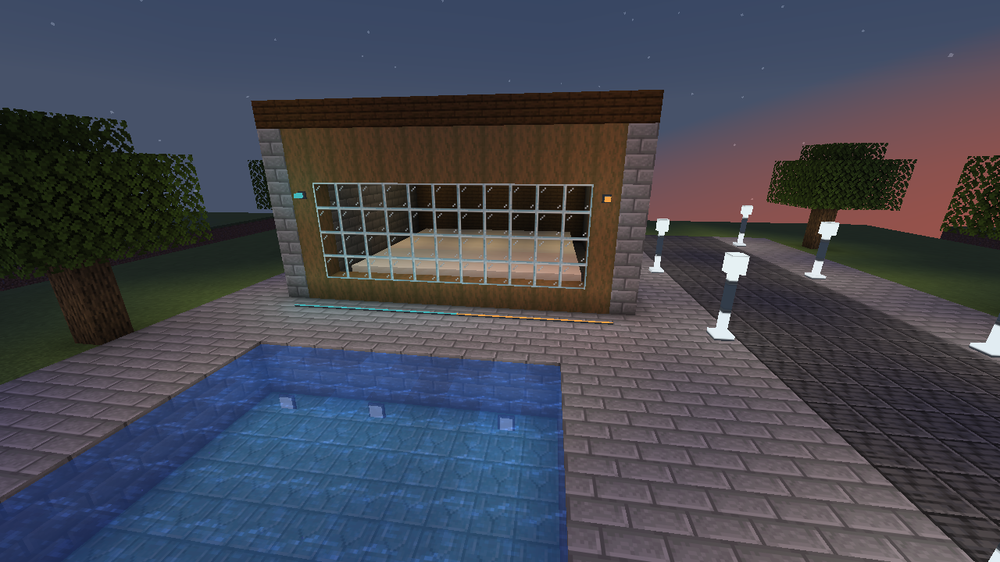

The original reference gallery demonstrates street posts, waterlogging, recipes, fence bulbs, normal/inverted redstone, corridor fixtures, slab/panel orientations and strip outlines. All these subjects have corresponding demonstrations below. Existing160 simplylight reference IDs have mapped functional counterparts; this is not automatic world-ID migration. Our frameless items/wrench are an independent alternative to the original CTM-dependent connected texture option, not the same implementation. Our recipes use our own vanilla-material approach, not identical old ingredient layouts.

## Portugues brasileiro

Todas as cenas foram construidas e fotografadas dentro do Minecraft, com a **Alpha16 publica**, sem shaders e somente Minecraft/NeoForge/nosso mod. Usamos os temas da galeria antiga como referencia para demonstrar as funcoes. Nenhuma imagem, textura ou construcao original foi copiada; nenhuma foto foi gerada por IA.

A capa e a miniatura vieram do jogo. A miniatura foi apenas recortada/redimensionada. As folhas de receitas juntam recortes da bancada real, com legendas; ingredientes, resultados e quantidades nao foram redesenhados. Os acabamentos sem moldura e a chave substituem a necessidade de CTM de outro jeito; nao sao a mesma implementacao. As receitas usam materiais vanilla e logica propria, sem prometer os mesmos ingredientes do antigo.

## Street posts / Postes na rua

Three blocks tall, placed as complete posts. / Tres blocos de altura, montados como postes completos.

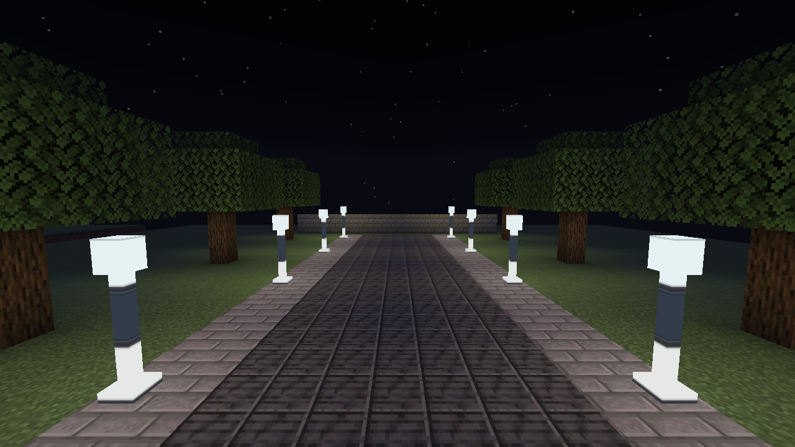

## Bulbs on fences / Bulbos nas cercas

Small lights on fence posts. / Luzes pequenas nos postes das cercas.

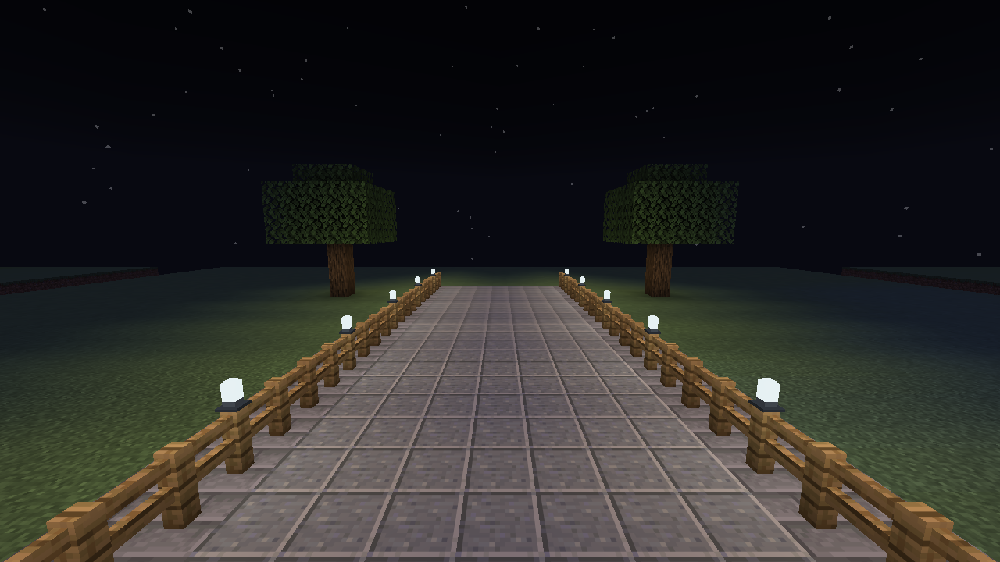

## Waterlogged lights / Luzes dentro da agua

Slab, panel, fixture, bulb, lower strip, upper strip and rod in water. The scene builder checked actual water fluid states for all seven. / Sete formatos com estado real de agua conferido.

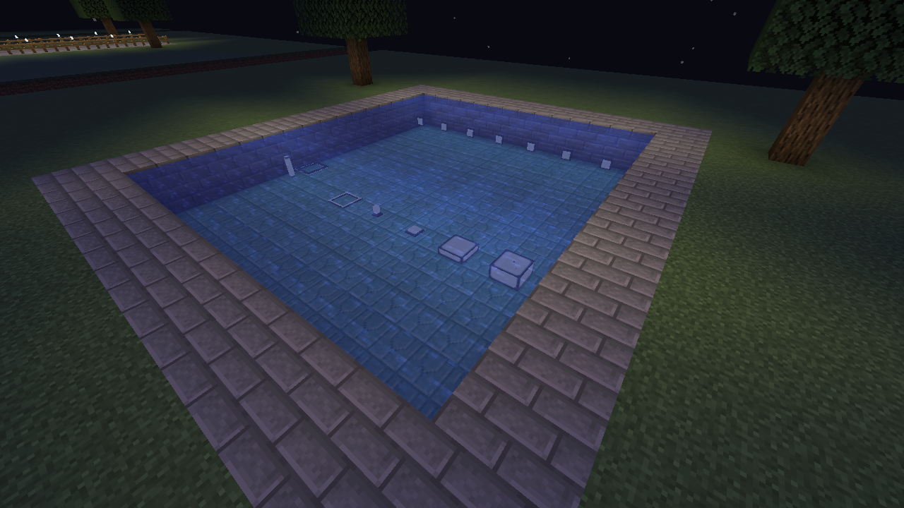

## Normal and inverted / Normal e invertida

Normal on the left, inverted on the right. Both receive redstone power. / Normal a esquerda e invertida a direita, ambas recebendo sinal.

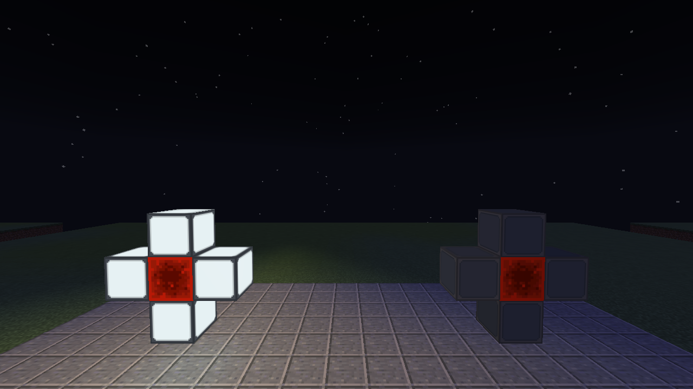

## No signal / Sem sinal

Same lights with the source removed: normal off, inverted on. / As mesmas luzes sem sinal: normal apaga, invertida acende.

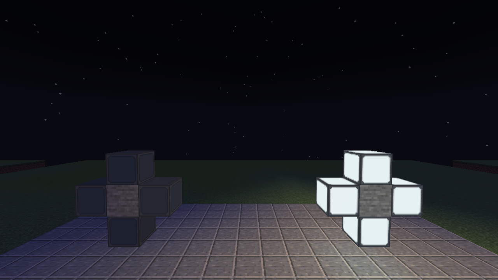

## Corridor / Corredor

Bulbs on one wall, fixtures on the other and ceiling, strips at floor level. / Bulbos, arandelas e fitas de piso na mesma construcao.

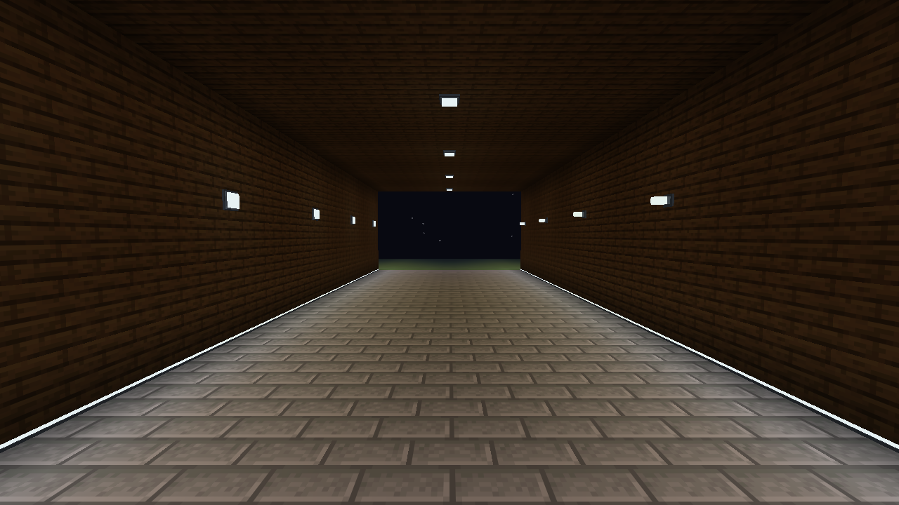

## Orientations / Orientacoes

Actual slabs and panels facing floor, ceiling and walls. / Lajes e paineis em orientacoes reais.

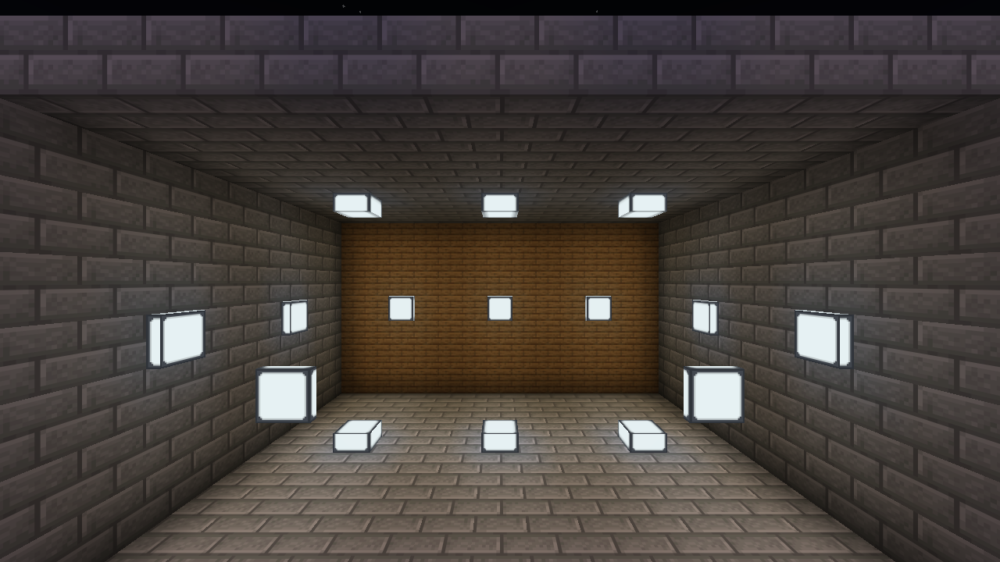

## Edge shapes / Direcoes das fitas

One strip per lapis block; border masks form a continuous outline. / Uma fita por bloco de lapis; os lados configurados formam o contorno.

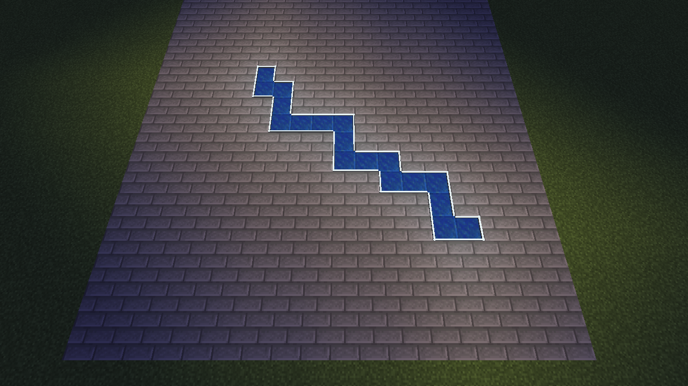

## Recipes / Receitas

Twelve crops from real vanilla crafting screens, including materials, counts and reusable finishing tool. / Recortes de doze crafts reais, com ingredientes e quantidades inalterados.

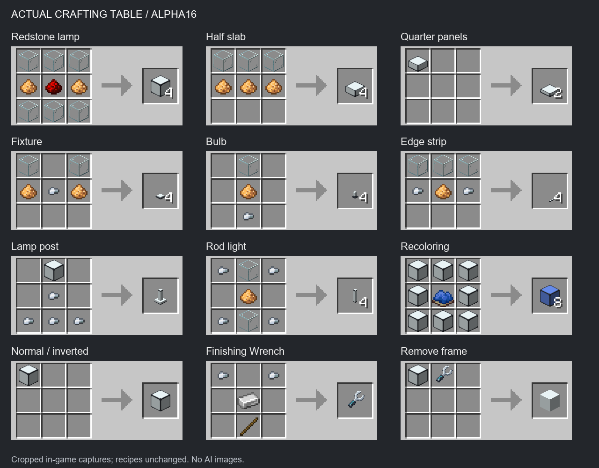

## Receitas em portugues

Same crafting screenshots, Portuguese labels. / Mesmas capturas da bancada, com legendas em portugues.

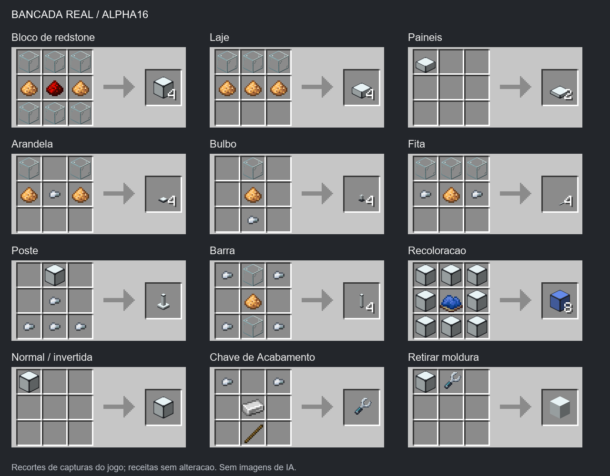

## Verification and provenance / Verificacao e origem

- Captures:1280x720, volume0, auxiliary single-player world only, no Windows mouse/keyboard input. Native RGB is enabled on the cover; functional comparison scenes use ordinary Minecraft lighting.
- Both redstone states were read back from the real server world: four normal and four inverted lights. Power and LIT states are retained locally. The pool builder checked actual water fluid states for seven small forms; post construction checked each three-part structure. These are focused scene checks, not a rerun of every engine test.
- The recipe sheets reuse our earlier Alpha16 in-game crafting captures; those fixtures took the actual result from every photographed recipe. The reusable wrench and vanilla Crafter checks remain documented in[VALIDATION.md](VALIDATION.md).
- A separate native-RGB screenshot of this build does not establish RGB water shading: environmental RGB still targets nearby block surfaces, with documented entity/fluid/partial-occlusion limits.
- Original inspiration: [Simply Light by Flanks255](https://www.curseforge.com/minecraft/mc-mods/simply-light). [Functional comparison](COMPARISON.md). Independent and unofficial; no affiliation implied.
