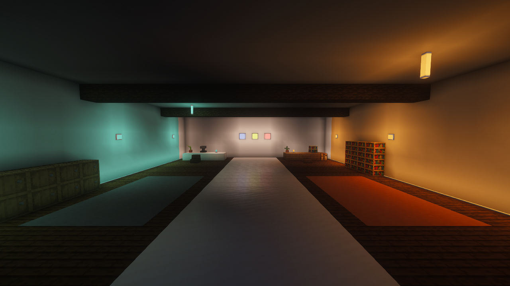
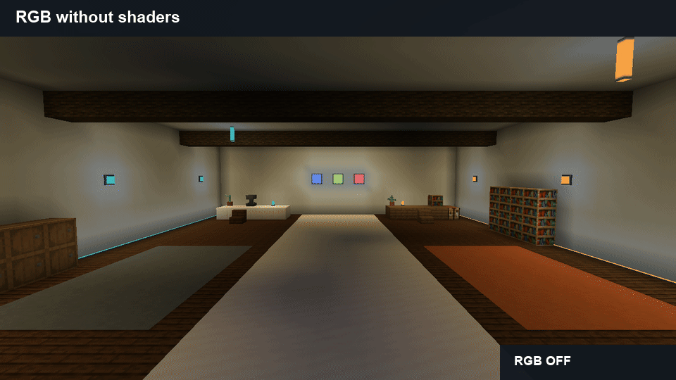
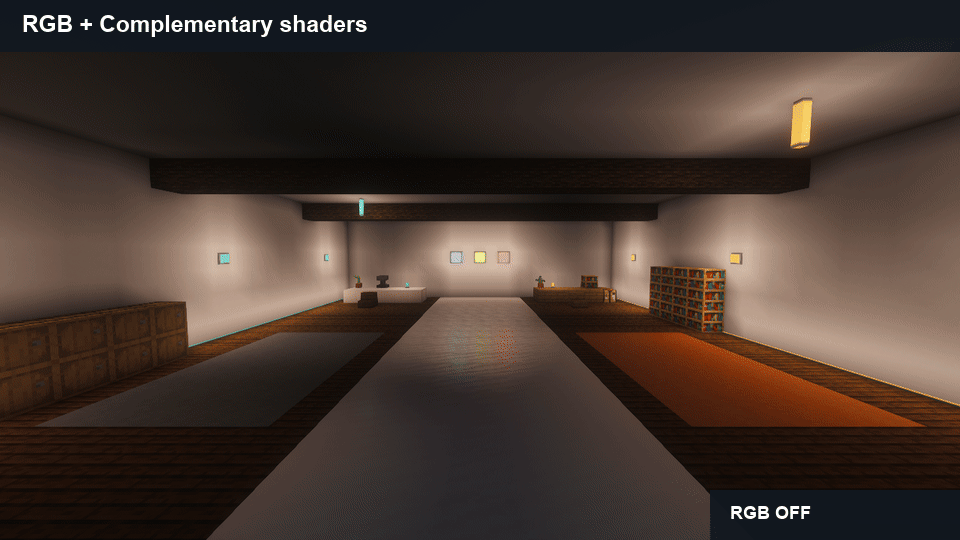
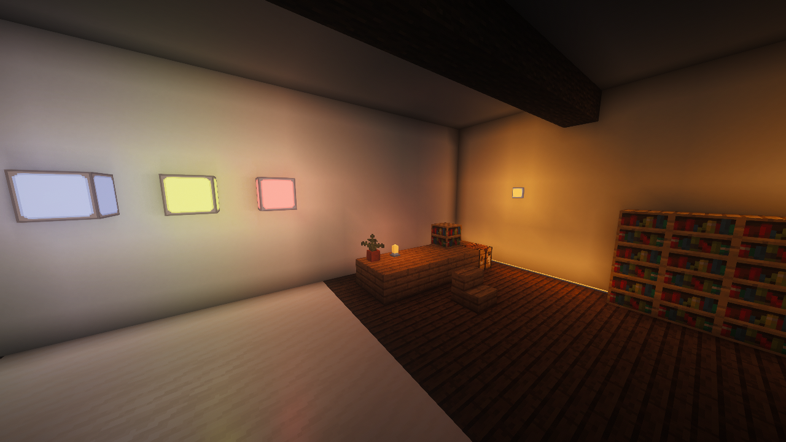
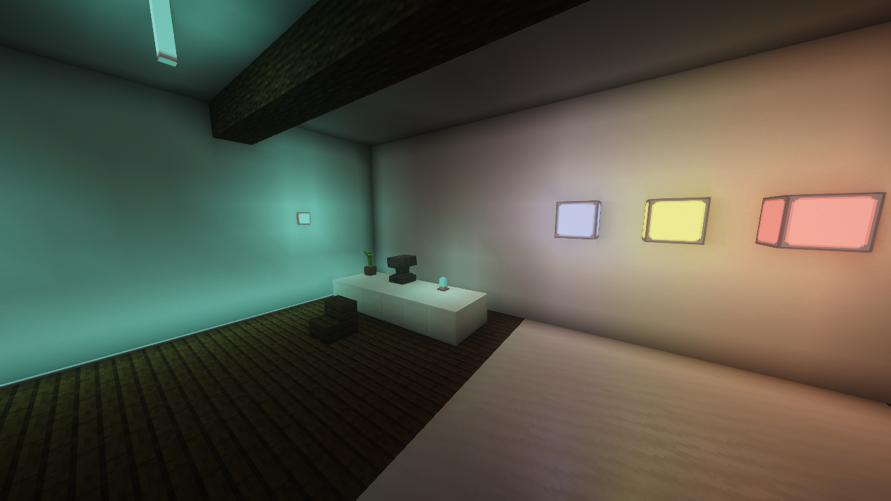
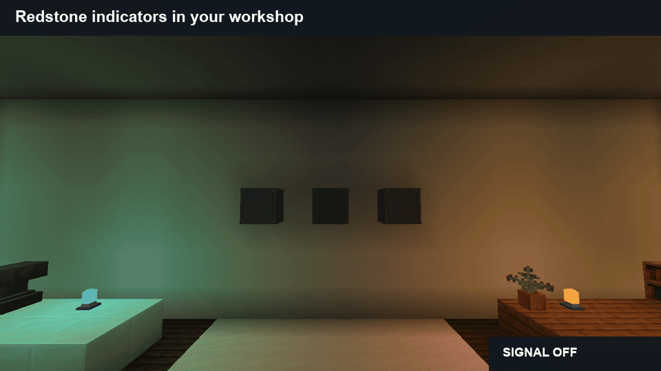
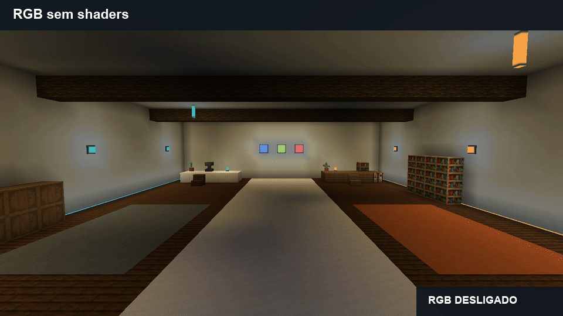
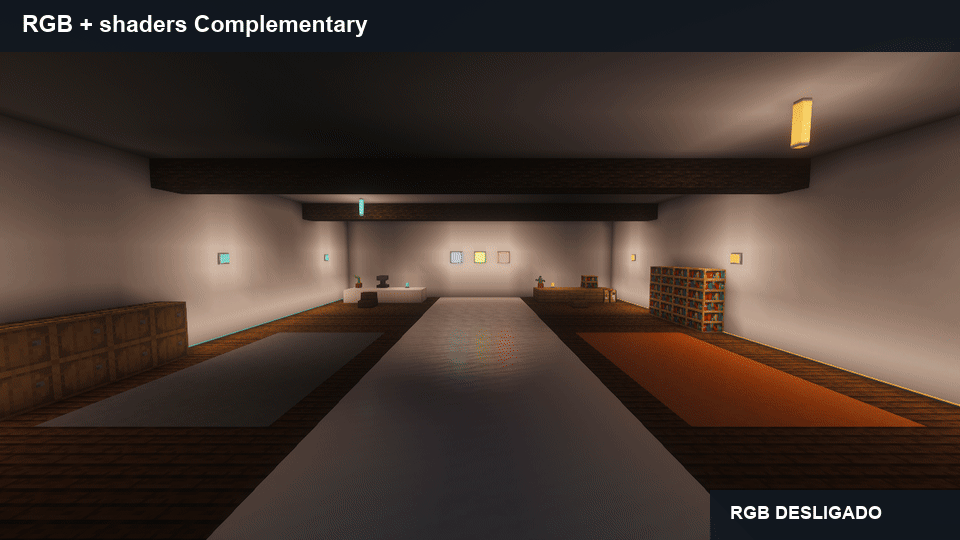
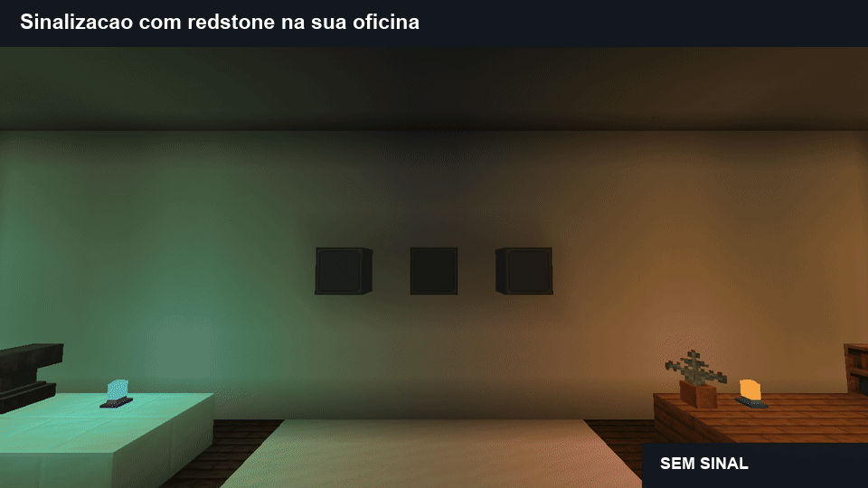

# Lighting in use / Luzes em uso

## English

### Lighting for places you actually build

Give your crafting corner a warm desk lamp. Run slim light strips along a corridor. Use redstone lamps as status indicators. Build a clean wall of color with frameless lights.

The workshop below uses our bulbs, wall fixtures, ceiling rods and floor strips together. These are actual in-game captures of Alpha16, not concept art.

*Workshop shown with Sodium, Iris and ComplementaryUnbound r5.9.3. Shaders are optional.*

### RGB without a shader pack

The same room, the same camera: watch the walls and floor change when environmental RGB is enabled. This capture runs with **only Minecraft, NeoForge and this mod**. You do not need another lighting addon.

The lamps illuminate in both states. RGB adds color to nearby block surfaces; it is an optional client setting, **off by default in this Alpha**. Set `nativeRgbEnabled = true` in `config/lumaworks-client.toml`, then restart the client.

### RGB with shaders

Prefer a shader look? Here is the same workshop in the FTB Evolution 2 test copy with Sodium 0.9.2, Iris 1.11.4 and original ComplementaryUnbound r5.9.3. The comparison switches our RGB layer off and on while keeping the shader active.

Compatibility was checked with this combination; every shader handles colors differently. Entities, fluids, partial occlusion and fast continuous changes still have limits.

### Useful details, up close

The small lights shown here are always on in Alpha16. Redstone control is currently available on the full-block lamps; normal lamps turn on with a signal and inverted lamps turn off.

### Tested in game

All **224 blocks and 520 recipes** were checked, alongside English/Portuguese, water, directions, redstone and the reusable tool in the vanilla Crafter. Dedicated checks passed **34,633 assertions**. The previous full-pack run lasted **10 minutes 42 seconds**, including 256/4,096-light scenes and Complementary, near the normal **20 TPS** server target.

We also measured this furnished workshop with RGB off/on, with and without Complementary. There is no ticking block entity or task per lamp. **Client frame-time spikes remain, including in RGB-off controls.** The version is Alpha, not a promise of zero lag. [Read the measurements and limits](https://github.com/Tech-teste/refeito-simply-light/blob/main/docs/SHOWCASE.md#measurements).

---

## Português brasileiro

### Luzes para as construções do dia a dia

Uma luminária quente na bancada. Fitas discretas guiando o corredor. Blocos de redstone indicando o estado das máquinas. Paredes coloridas contínuas com as versões sem moldura.

A oficina usa bulbos, arandelas, barras de teto e fitas de piso juntos. As imagens são capturas reais da Alpha16 no Minecraft; a versão com shaders usa ComplementaryUnbound r5.9.3.

### RGB sem shaders

O mesmo ambiente e a mesma câmera: veja as paredes e o chão receberem cor ao ligar o RGB. Esta captura usa **somente Minecraft, NeoForge e este mod**, sem addon de iluminação.

As luminárias iluminam nos dois estados. O RGB acrescenta cor às superfícies próximas. Nesta Alpha ele começa **desligado**: ative `nativeRgbEnabled = true` em `config/lumaworks-client.toml` e reinicie o cliente.

### RGB com shaders

Aqui o Complementary continua ativo enquanto ligamos e desligamos nossa camada de cor, na cópia de teste do FTB Evolution 2 com Sodium/Iris.

Cada shader pode tratar as cores de um jeito. Entidades, fluidos, oclusão parcial e mudanças rápidas ainda têm limitações.

### Sinalização para sua oficina

Na Alpha16, os blocos inteiros aceitam redstone normal/invertida. As luminárias pequenas mostradas ficam sempre acesas; versões pequenas controláveis ainda não fazem parte desta versão.

### Desempenho conferido

Foram conferidos os **224 blocos, 520 receitas, os dois idiomas e 34.633 verificações do servidor**, incluindo redstone e a chave no Crafter. O teste anterior no pack durou **10min42s**, com cenas de até 4.096 luzes, mantendo TPS próximos de 20.

Também medimos esta oficina com RGB ligado/desligado, com e sem Complementary. Não há entidade de bloco ou tarefa rodando por lâmpada. **Ainda apareceram engasgos gráficos, inclusive com RGB desligado.** A Alpha não promete zero lag. [Veja as medições e os limites](https://github.com/Tech-teste/refeito-simply-light/blob/main/docs/SHOWCASE.md#measurements).

---

## Measurements

Four 30-second windows in the same furnished workshop, each with six changes to three full-block redstone lamps. RGB off/on, standard Sodium rendering and original Complementary. Minecraft26.1.2, NeoForge26.1.2.126, Sodium0.9.2, Iris1.11.4, Alpha16. Only our full-pack test client was running; the standalone capture client was closed. Other applications still shared the machine. Offscreen1280×720, no Windows mouse/keyboard input. Temporary render options and observer listeners were restored/removed.

These are real frame intervals and server-tick durations, not samples of the FPS counter. Higher TPS up to the normal20 target is better; lower millisecond values are better. The frame p99 means99% of measured frame intervals were at or below that value. The largest frames are shown too so isolated stutters are not hidden. Offscreen results cannot promise the same visible-game FPS on your hardware.

| Renderer | RGB | TPS | Tick p95 (ms) | Frame p99 (ms) | Longest frame (ms) | Frames >50ms |
|---|---|---:|---:|---:|---:|---:|
| Sodium, no shaders | Off | 19.99 | 6.76 | 5.12 | 650.98 | 18 |
| Sodium, no shaders | On | 20.00 | 6.14 | 6.00 | 249.30 | 10 |
| Sodium + Complementary | Off | 20.00 | 6.00 | 7.04 | 74.77 | 1 |
| Sodium + Complementary | On | 19.99 | 5.51 | 6.84 | 58.03 | 1 |

Both RGB and RGB-off runs had isolated client stalls. This comparison does not establish a universal speedup or identify every cause. A smooth-looking GIF is not a performance benchmark: these GIFs alternate real captures and intentionally hold each state for2.5seconds.

No runtime code was changed for this gallery. The distributed Alpha16 jar is unchanged. The earlier 642-second soak and its larger spikes remain documented in [VALIDATION.md](VALIDATION.md); the new windows do not replace it. One earlier full-pack startup failed at registry bootstrap, and an unchanged retry passed; its cause remains unresolved.

## Medições em português

Quatro janelas de30segundos na mesma oficina, alternando três indicadores de redstone seis vezes. O cliente independente já estava fechado. As opções temporárias foram restauradas; não usamos mouse/teclado do Windows no jogo.

TPS próximos de20 mostram que o servidor acompanhou a simulação nessas janelas. Os tempos de quadro revelam também os engasgos: há picos tanto com RGB quanto sem ele. Não é promessa de FPS universal ou zero lag. O GIF alterna fotos reais, segurando cada estado por2,5segundos; não serve para demonstrar fluidez.

O jar público não mudou. Permanecem os limites da Alpha para entidades/fluidos/oclusão parcial e mudanças rápidas, além da falha de inicialização anterior sem causa isolada. O teste anterior de10min42s continua válido e não foi substituído por amostras mais favoráveis.
