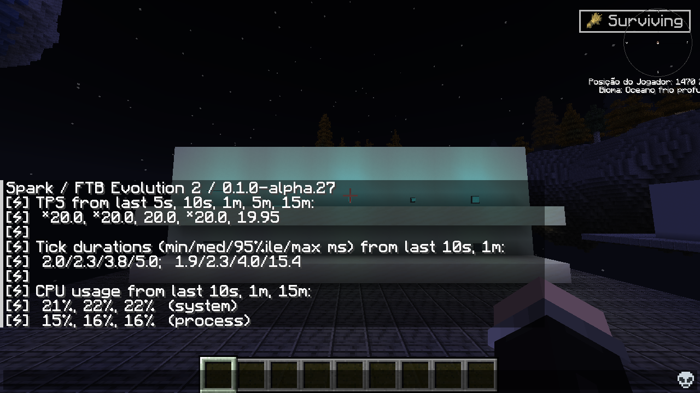

# Alpha27: diagnosing the captured pack spikes

This is a separate instrumented diagnostic, not a new clean FPS benchmark. Minecraft26.1.2 / NeoForge26.1.2.126, FTB Evolution2 auxiliary, Sodium0.9.2, Iris1.11.4 installed with shaders off. JFR profile recording was checked running after every window and checkpoint dumps were nonempty. The8 windows total240.02 s, RGB order off/on/on/off/on/off/off/on, fast redstone period2 ticks.

48,000 emission checks across2,400 transitions passed; every settling checkpoint reached pending0/noRGBerror. The source/binary mod was unchanged. JFR and the measurement helper add diagnostic overhead.

## The379 ms tick

The measured slow tick lasted379.0159 ms.16 execution/native samples fell inside its exact recorded start/end times on the Server thread.15 included world-save paths (SavedDataStorage, ChunkMap.saveAllChunks, attachment serialization); no sampled NativeRgb/own production method appeared in that span and noGCpause overlapped it. Samples also passed through pack attachment serialization, including Witchery poppet data. This supports world saving as a substantial contributor to this captured tick. It does not establish the cause of every historical spike or prove zero mod cost.

## The long render intervals

At204.4289 ms with RGB off,14 render-thread samples overlapped:12 included recipe-viewer/catalog paths and8 included SCC analysis. At225.4481 ms with RGB on,20 samples overlapped:19 included both SCC analysis and recipe-viewer/catalog paths. A167.0913 ms span contained SCC analysis in11 of12 samples. These are overlapping inclusive classifications, not additive or exclusive CPU percentages.

Stacks include de.scc.calculator.calc.AnalysisJob.stepScan / AnalysisManager.tick, JEI recipes and SophisticatedCore recipe-viewer catalog work. Background recipe analysis was still active despite the2 minute warmup, so these intervals cannot isolate an RGB FPS penalty. A164.0205 ms span also overlapped a42.0332 ms GCpause. The recording had GCpauses up to73.4986 ms overall.

No autosave, pack mod, shader feature or world-safety setting was disabled to make the results look better. Changes to another mod are outside this correction unless specifically requested. A warmed, completed-index comparison is still needed for a narrower RGB cost claim.

## Actual Spark snapshot

spark tps returned20.0 TPS in its5 s/10 s/1 m/5 mwindows and19.95 over15 m. Its recent10 s/1 mtick maxima were5.0/15.4 ms. The screenshot was taken after the diagnostic windows; those recent maxima do not include the earlier379 ms tick. Do not use this snapshot alone to advertise no lag.

## Português brasileiro

O tick de379 ms coincidiu com pilhas de salvamento/serialização do mundo em15 das16 amostras da thread do servidor. Não apareceu código RGB nessas amostras específicas, nem pausaGCsobreposta. Isso aponta uma contribuição relevante do salvamento nesse evento; não elimina custo do mod nem explica automaticamente todos os picos antigos.

Os maiores intervalos de quadro mostraram análise de receitas SCC e catálogo JEI/SophisticatedCore na thread de renderização, com RGB desligado e ligado. A análise do pack continuava ativa após o aquecimento. Um intervalo também coincidiu parcialmente com uma pausaGC. São amostras de diagnóstico com sobrecarga de gravação, sem porcentagem universal de FPS.

O comando real Spark mostrou20 TPSrecentes, mas a captura posterior não inclui o pico anterior no máximo do último minuto. As48 mil verificações de emissão passaram e as filas zeraram ao estabilizar. ArquivoJFR bruto fica privado; apenas o resumo sem dados do processo é preparado para publicação.

Evidence: diagnosis-public.json, jfr-summary.json (method names), windows.json, Spark screenshot and restoration.json. The first helper-created recording attempt failed collection; see the separate pack-profile/diagnostic-failure.json. Its empty trace is not used in this analysis.

Actual Spark output after the run: the recent maxima do not include the earlier379ms tick. / Saída real posterior: os máximos recentes não incluem o tick anterior de379ms.
